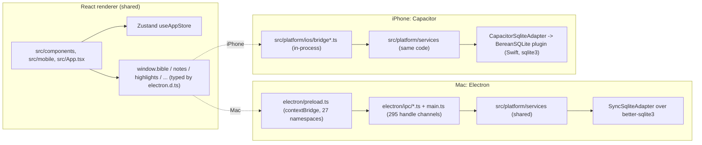
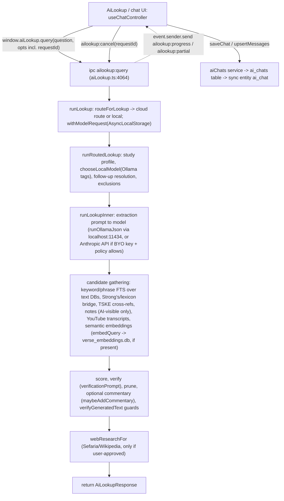
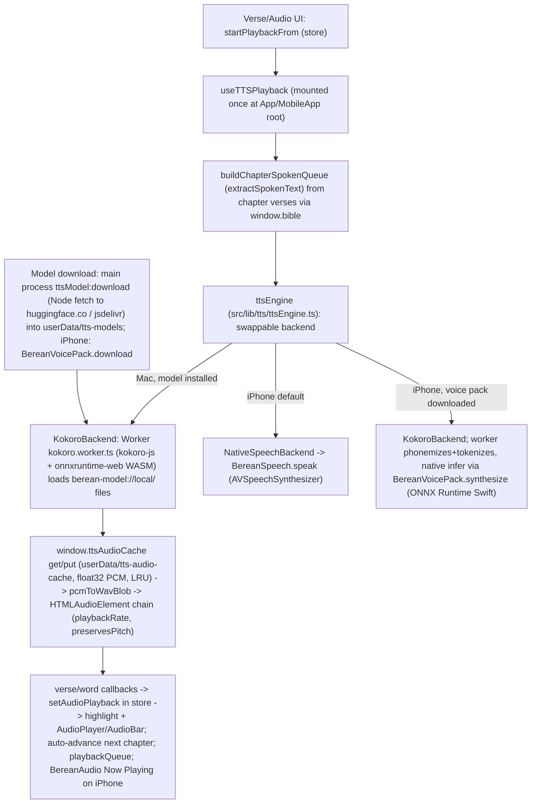

# 02 - Current Architecture (audit snapshot)

> **Baseline note.** Investigated at `807c2d9`. The final baseline is `d97fb05`. The only code changes between them are PRs #9, #10 and #11, listed in `01-REPOSITORY-STABILIZATION.md`: fixes for sync defects D1-D4, note table-cell formatting, and audio cache keys. Anything below describing those defects as present is corrected where noted.

Audit of commit `807c2d974b795f95f4c05b8ae4b6796c273b572c` (package.json version 0.8.1, iOS `CURRENT_PROJECT_VERSION = 7`), checkout `/Users/roywe/Berean-audit`, detached HEAD, read-only. Purpose: input to a possible later migration to fully native Swift. Nothing here recommends implementing anything now.

Confidence labels: **VERIFIED** = read in code or measured with wc/grep/find/node scripts during this audit. **INFERRED** = follows from verified code but was not observed running. **UNVERIFIED** = stated by docs/comments but not confirmed. **BLOCKED** = could not be checked under the audit rules (no builds, no dev server, no ollama).

CLAUDE.md and `docs/` are partly stale; where they disagree with code, code wins and the discrepancy is listed in section 19.

Measured by static scripts only (the sandbox rules forbid running the app or the test suite). Counts of call sites, test cases and IPC channels come from regex scans and are exact for the pattern stated, not necessarily for every dynamic call path.

---

## 1. Shape of the system

| Item | Measured value | Label |
|---|---|---|
| TypeScript/TSX in `src/` (non-test) | 141,458 lines | VERIFIED |
| TypeScript in `electron/` (non-test) | 17,036 lines | VERIFIED |
| Test code (`*.test.ts(x)` under src, electron, tests, scripts) | 47,024 lines, 384 files | VERIFIED |
| CSS | 7,068 lines (`src/styles/global.css` 2,459; `pmEditor.css` 1,214; `mobile.css` 965) | VERIFIED |
| Swift (iOS app, plugins, share extension, widget; excluding generated CapApp-SPM) | 3,095 lines, 23 files | VERIFIED |
| Objective-C (Node-API addons) | 451 lines, 2 files | VERIFIED |
| Python data scripts | 54 files, 10,713 lines | VERIFIED |
| Node/shell scripts | 65 files, 5,686 lines | VERIFIED |
| Bundled SQLite data (`data/*.db`, gitignored, symlinked in this checkout to the main working tree) | 27 files; sizes in doc 14 | VERIFIED |
| Schema version of `berean.db` | 49 (`src/platform/db/bereanMigrations.ts`, `BEREAN_MIGRATIONS`) | VERIFIED |

Three deliverables come out of one TypeScript codebase:

1. **Mac app**: Electron 32 main process + Chromium renderer(s), `electron-vite` build (`electron.vite.config.ts`).
2. **iPhone app**: the same React renderer built by `vite.ios.config.ts` into `out/ios`, hosted in a Capacitor 8 `WKWebView`, with 14 first-party Swift Capacitor plugins (`ios/App/BereanNative`).
3. **Windows installer**: `release.yml` has a `windows-latest` job producing an NSIS x64 installer (CLAUDE.md calls Windows "deferred"; the CI job exists and `package.json` has a `win` block). Not verified that it is shipped. INFERRED.

The central architectural trick: the renderer calls `window.<namespace>.<method>()` (typed in `src/types/electron.d.ts`, 1,111 lines). On the Mac those objects are `contextBridge` proxies over Electron IPC (`electron/preload.ts`). On iPhone the same objects are installed in-process by `src/platform/ios/bridge.ts`/`bridgeExtras.ts`/`syncHost.ts`, backed by the same shared service layer (`src/platform/services`) over a different database adapter. VERIFIED.



---

## 2. Entry points

### 2.1 Electron main - `electron/main.ts` (2,201 lines) - VERIFIED
- Before `app.whenReady()`: writes a startup breadcrumb log to `~/Library/Containers/<bundleId>/Data/berean-startup.log` via a held fd (`earlyLog`), registers the privileged `berean-model:` scheme (`registerTTSModelScheme`), sets `autoplay-policy=no-user-gesture-required`, and sets `userData` to `appData/<APP_IDENTITY.userDataDir>` (`Berean` or `Berean-dev`, from `config/app-identity.json`).
- Dev-only environment hooks: `BEREAN_QA_USER_DATA`, `BEREAN_CDP_PORT` (remote-debugging port), `BEREAN_PERF_LOG`.
- `app.whenReady()` order: GPU/switch logging, dock icon (dev), About panel, `Menu.setApplicationMenu(buildAppMenu())`, `restoreFolderAccess()` (MAS security-scoped bookmarks), `initBereanDb()` (open + migrate), `initDesktopServices()`, `initSyncHost()` (async, no-op until iCloud sync enabled), `session.fromPartition('persist:youtube')`, permission handler (geolocation + clipboard only), then `registerXxxHandlers` for each IPC module, CSP header handler, `createWindow()`, deferred `mergeYouTubeSeed`, auto-updater setup.
- `will-quit`: `runExportAll()` (vault export), `closeBereanDb()`, `closeAllTextDbs()`, `closeLexiconDbs()`.

### 2.2 Preload - `electron/preload.ts` (755 lines)
28 `contextBridge.exposeInMainWorld` calls (27 namespaces plus the `__berean_platform` string = `process.platform`). Members and channel counts in section 5. VERIFIED.

### 2.3 Desktop renderer - `src/main.tsx` (248 lines) and `src/App.tsx` (1,105 lines)
`src/index.html` is the single HTML shell for **every** Electron window. `src/main.tsx` reads `window.location.search` and picks the root component:

| Query | Root | Window |
|---|---|---|
| (none) / `independent=1` / `mirror` | `<App/>` | Main window (peer or standalone) |
| `float=1` | `FloatingShell` | Pop-out tab window |
| `viewer=1` | `ViewerApp` | Presenter/viewer window |
| `studyTrail=1` | `StudyTrailApp` | Study Trail window |
| `versePicker=1` | `VersePickerApp` | Verse picker child window |
| `chat=1` | `ChatWindowApp` (lazy) | Berean Chat window |

It also stamps `data-window` / `data-vibrant` on `<html>` for CSS, applies Liquid Glass tokens (`src/platform/liquidGlass`), and installs scrollbar auto-hide and the window-active stamp. VERIFIED.

### 2.4 iPhone renderer - `src/platform/ios/main.tsx`, `src/index.ios.html`, `vite.ios.config.ts`
`vite.ios.config.ts` roots at `src/`, outputs `out/ios` (Capacitor `webDir`), targets `safari17`, defines `VITE_PLATFORM=ios`, `VITE_APP_VERSION`, optional `VITE_E2E_PROBE`, injects a WKWebView CSP meta tag (`src/platform/ios/csp.ts`) and renames `index.ios.html` to `index.html`. `src/platform/ios/main.tsx` `boot()` sequence: dev probe, native glass plugin install, `initIosServices()` (open `berean.db`, run shared migrations, open bundled DBs read-only), `installIosBridge`, `installIosBridgeExtras`, `installIosSyncBridge`, deferred `initIosSyncHost` (after first paint plus 1.5 s), deep links, Spotlight, share inbox, Read Aloud backend (`NativeSpeechBackend` over `BereanSpeech`), voice pack, then render `src/mobile/MobileApp.tsx`. VERIFIED.

### 2.5 Capacitor and Swift app shell
- `capacitor.config.ts`: `appId com.berean.app` (overridden at build by `Identity.xcconfig`), `webDir out/ios`, scheme `Berean`, `includePlugins` allow-list of 9 `@capacitor/*` plugins (geolocation deliberately excluded, ITMS-90683), `Keyboard.resize none`, `StatusBar.overlaysWebView`, `CapacitorHttp.enabled` (native HTTP for CORS-less endpoints). VERIFIED.
- `ios/App/App/AppDelegate.swift` (44 lines): `@UIApplicationMain`, empty lifecycle stubs, scene configuration only.
- `ios/App/App/SceneDelegate.swift` (30 lines): creates the `UIWindow` with `BereanBridgeViewController`, forwards URL and user-activity events to Capacitor's `SceneDelegateProxy`, and Spotlight continuation to `BereanSpotlightPlugin.handleContinuation`.
- `ios/App/App/BereanBridgeViewController.swift` (42 lines): subclass of `CAPBridgeViewController`; in `capacitorDidLoad` sets background colors, hides the iOS 26 top edge effect, and registers 14 plugin instances (`BereanSQLite`, `BereanCloud`, `BereanAudio`, `BereanSpeech`, `BereanVoicePack`, `BereanWebView`, `BereanDownloads`, `BereanPrint`, `BereanSpotlight`, `BereanShareInbox`, `BereanPower`, `BereanA11y`, `BereanLocation`, `BereanGlass`).
- Extra Xcode targets (from `project.pbxproj`): `App` (application), `ShareExtension` (app-extension), `BereanWidget` (app-extension). Deployment target iOS 17.0, iPhone only (`TARGETED_DEVICE_FAMILY = 1`), Swift 5.0 language mode. VERIFIED.

---

## 3. Electron main process responsibilities

1. **Lifecycle and identity**: userData path, startup logging, single-instance + `second-instance`, `open-url` deep links (`berean:` and `berean-pdf:` schemes), `activate`, `window-all-closed`, `will-quit`.
2. **Database ownership**: opens `berean.db` (`electron/db/berean.ts`), read-only bundled text DBs (`electron/db/bible.ts`, 19 text ids), lexicon DBs (`electron/db/lexicon.ts`), optional embeddings DB (`electron/db/embeddingsDb.ts`). Builds the shared `ServiceContext` (`electron/servicesHost.ts`).
3. **IPC handlers**: 295 `handle` channels, 22 `ipcMain.on` plus 1 `ipcMain.once` (section 5).
4. **Window management**: nine kinds, section 4.
5. **Native menu**: `buildAppMenu()` (File/Edit/View/Go/Window/Help; menu actions go to the renderer as `berean:menuAction`).
6. **Auto-update**: `electron-updater` against GitHub Releases; checks at +6 s (retry +20 s) and every `UPDATE_CHECK_INTERVAL_MS = 5 * 60 * 1000`; opt-in auto-download; beta channel via `allowPrerelease`. MAS build reports status `mas`.
7. **Vault sync (Octarine/Obsidian markdown mirror)**: `electron/ipc/vault.ts` (1,449 lines), chokidar watcher, 5-minute auto-export timer, hourly trash purge with 30-day retention.
8. **iCloud sync host**: `electron/sync/host.ts` runs `SyncEngine` over `FsSyncStore` (plain files in the ubiquity container).
9. **AI**: local Ollama client, cloud provider routing, embeddings, the entire Ask Berean retrieval pipeline (`electron/ipc/aiLookup.ts`, 4,156 lines, the second largest file in the repo).
10. **Network**: YouTube Data API + InnerTube + RSS (`electron/ipc/youtube.ts`), BibleGateway notes import in a login-capable hidden window (`bgImport.ts`), Kokoro model download, Anthropic API.
11. **Secrets**: provider keys encrypted with Electron `safeStorage` (`electron/secrets/providerKeys.ts`, file `provider-keys.json`, mode 0600). The YouTube Data API key is a build-time constant in gitignored `electron/youtube-key.ts`, written from a CI secret. No secret values were read for this audit. VERIFIED.
12. **File access**: PDFs, note images, TTS caches, vault, MAS security-scoped bookmarks (`electron/mac/folderAccess.ts`, `sandbox-bookmarks.json`).
13. **Power**: `powerMonitor` on-battery/thermal state broadcast as `app:resourceModeChanged` (`electron/powerAwareness.ts`); sync resumes on `resume`.
14. **Security posture**: CSP injected (`electron/csp.ts`), `keepLinksOutOfApp`/`openExternalSafely` (`electron/externalLinks.ts`), `devToolsEnabled` gating. The six app windows and the BibleGateway windows use `contextIsolation: true`, `nodeIntegration: false` and explicit **`sandbox: false`**. The YouTube transcript worker windows use `contextIsolation: false` and leave sandbox at its default (dev-only transcript fetch). VERIFIED.

---

## 4. Window types (every BrowserWindow constructor)

| # | Window | Created by | Root / URL | Notes |
|---|---|---|---|---|
| 1 | Main window (peer, mirrored from another, or independent) | `createWindow()` main.ts:1119 | `index.html` (no query, `?mirror`, `?independent=1`) | `webviewTag: true` (YouTube), vibrancy on macOS, per-window renderer = own Zustand store. Multiple peers are supported; cross-window sync keeps a shared slice (section 7). |
| 2 | Floating pop-out tab | `createFloatingWindow()` :1053 | `?float=1&type=...` | `webviewTag: true`; returned to main via `app:returnFloatTab`. |
| 3 | Presenter / viewer | `createViewerWindow()` :778 | `?viewer=1` | Separate renderer; content/settings/overlay/visible-region pushed over IPC (`app:pushViewer*`, `viewer:*`). Opaque. |
| 4 | Study Trail | `createStudyTrailWindow()` :870 | `?studyTrail=1[&session]` | Own Zustand slice (`src/store/studyTrailSlice.ts`). |
| 5 | Berean Chat | `createChatWindow()` :944 | `?chat=1` | Lazy-loaded root; handoff with main via `chat:*` channels. |
| 6 | Verse picker | `createVersePickerWindow()` :1003 | `?versePicker=1` | Child window owned by a webContents id. |
| 7 | Hidden render windows (PDF/print/preview) | main.ts :1790, :1818 (cached `previewWin`), :1846 | `file://tmp`, `data:text/html` | `show:false`, `sandbox:false`; used by `app:printNote`, `app:exportNotePDF`, `app:renderPreviewPDF`. |
| 8 | BibleGateway import windows | `electron/ipc/bgImport.ts` :349, :793 | `https://www.biblegateway.com/user/annotations/` with partition `BG_PARTITION` | Real login page in a hidden or visible window, JS injected via `fetch` to scrape notes. |
| 9 | YouTube transcript workers | `electron/ipc/youtube.ts` :1071 | partition `transcript-worker-<id>`, loads `tactiq.io` | Dev-gated: `youtube:fetchTranscripts` and `youtube:clearTranscripts` return `{ error: 'unavailable in production' }` unless `devTools()` (`devToolsEnabled({isDev, identity})`) is true. VERIFIED. `contextIsolation:false`. |

Plus in-window `<webview>` tags: YouTube tab (`persist:youtube` partition) in `src/components/youtube/YouTubeTab.tsx`. VERIFIED (static).

---

## 5. IPC surface

### 5.1 Totals (VERIFIED by `/private/tmp/.../ch.mjs` scan of `electron/`, tests excluded)
- **295** `handle` channels = 276 `ipcMain.handle(` literals + 19 `ipc.handle(` (alias in `registerYouTubeHandlers`). 294 are invoked from `preload.ts`; the one that is not is the dev diagnostic `app:listHandlers`.
- **22** `ipcMain.on` + **1** `ipcMain.once` (one-way renderer-to-main). Preload exposes **23** `ipcRenderer.send` channels.
- **295** `ipcRenderer.invoke` call sites in preload (294 distinct channels), **47** `ipcRenderer.on` listener registrations (46 distinct channels).
- Main-to-renderer push channels found via `.send('...')`: **66** distinct (includes channel names used between windows).
- `ipcParity.test.ts` (electron/__tests__) fails if a preload `invoke` channel lacks a main handler, so drift is guarded for `invoke` but not for push channels.
- Registration is split across 27 files: `electron/main.ts` 40 handle, `electron/ipc/*.ts` 240 (youtube.ts's 19 included), `electron/liquidGlass.ts` 5, `electron/sync/host.ts` 10.

### 5.2 Handle channels by prefix (count)
studyTrail 43, app 33, notes 28 (+ folders 7 = 35 in notes.ts), ailookup 22, youtube 19, pdf 15, verseTags 13, sessions 11, sync 10, vault 9, chat 7, aiProviders 6, crossrefs 6, ttsModel 6, bgImport 5, bible 5, history 5, lexicon 5, tagGraph 5, workspaces 5, glass 5, aimodels 4, eSwordImport 4, playlists 4, ttsAudioCache 4, highlights 3, settings 3, cross-window 2, window 1.

### 5.3 Preload namespaces, member counts, iOS mirror status

Member counts are properties at object depth 1 in `preload.ts` (include `on*` listener registrars). iOS "present" = the member key exists in the `Window[...]`-typed object installed by `src/platform/ios/*` (static scan); "stub" = the iOS body is `noop`, `unavailable()`, or returns empty.

| Namespace | Preload members | iOS present | Notes |
|---|---:|---:|---|
| bible | 5 | 5 | `bridge.ts` |
| notes | 36 | 36 | `bridge.ts`; vault mirror on trash stays desktop-only |
| lexicon | 5 | 5 | |
| highlights | 3 | 3 | |
| verseTags | 13 | 13 | |
| tagGraph | 5 | 5 | |
| settings | 3 | 3 | |
| crossrefs | 6 | 6 | |
| appHistory | 5 | 5 | |
| workspaces | 5 | 5 | |
| playlists | 4 | 4 | |
| sessions | 11 | 11 | |
| studyTrail | 44 | 44 | `bridgeExtras.ts` |
| sync | 12 | 12 | `syncHost.ts` (`installIosSyncBridge`) |
| pdf | 15 | 15 | bytes in app container via `@capacitor/filesystem` |
| youtube | 20 | 20 (3 unavailable) | `fetchTranscripts`, `clearTranscripts` throw; fetch layer is `youtubeFetchService` over WebView `fetch` + `CapacitorHttp` |
| aiLookup | 36 | 24 | `query` runs `modelFreeLookup` (no LLM); `commentary` throws; provider keys, local-model management, `cancel` absent |
| app | 70 | 54 (36 stubs/no-ops) | multi-window, menu, updater, theme-source, trackpad, accent members are no-ops |
| crossWindow | 7 | absent | |
| viewer | 6 | absent | |
| chatWindow | 14 | absent (chat is an in-app overlay on iPhone) | |
| vault | 10 | absent | |
| eSwordImport | 5 | absent | |
| ttsModel | 8 | absent (replaced by `BereanVoicePack`) | |
| ttsAudioCache | 4 | absent | |
| windowControls | 6 | absent | |
| bgImport | 6 | absent | |
| `__berean_platform` | string | `'ios'` | |

Totals: 364 preload members; 270 present on iOS by scan. VERIFIED (static).

### 5.4 Renderer callers (regex `window.<ns>.<member>`, `src/` excluding tests)
Files / call sites: notes 49/180, app 53/163, studyTrail 17/112, bible 39/71, settings 14/43, lexicon 18/40, youtube 7/36, highlights 8/24, verseTags 11/19, pdf 6/18, crossrefs 8/16, aiLookup 9/16, vault 5/16, ttsModel 3/15, windowControls 2/15, workspaces 5/14, viewer 3/8, chatWindow 4/8, playlists 4/8, tagGraph 1/7, appHistory 4/6, sync 7/6, bgImport 4/6, ttsAudioCache 2/5, eSwordImport 4/4, crossWindow 2/2. Understated for optional-chained or aliased access (`sessions` shows 0 call sites because it is accessed through `window.sessions!` / destructured in `tabPersistenceRuntime.ts`). INFERRED where aliasing is likely.

### 5.5 Bridges that are not request/response IPC
- Cross-window relay: `cross-window:broadcast|sendTo|list|selfId` (main.ts) is a dumb relay; semantics live in `src/lib/crossWindowSync.ts`.
- Service change fan-out: `installCrossWindowChangeBroadcast` in `electron/servicesHost.ts` converts `data:changed` events into `notes:changed` / `studyTrail:dataChanged` pushes, skipping the originating window via `withSender` (AsyncLocalStorage).
- Streaming progress: `ailookup:progress`, `ailookup:partial`, `aimodels:progress`, `ttsModel:downloadProgress`, `ttsModel:downloadVerifying`, `bgImport:progress`, `eSwordImport:progress`, `youtube:progress`, `vault:changed`, `sync:status`, `sync:applied`.
- Custom protocol: `berean-model://local/` serves downloaded Kokoro files from `userData/tts-models` (`electron/ttsModelProtocol.ts`).

---

## 6. Shared services layer - `src/platform/services`

24 files, 6,315 lines (VERIFIED). Contract: services import neither Node, Electron, nor Capacitor (`src/platform/__tests__/importBoundaries.test.ts` enforces this for `src/platform/services`, `sync`, `db`, `src/lib`, `src/store`).

```
ServiceContext {
  userDb: DatabaseAdapter            // berean.db
  textDb(textId) / lexiconDb(H|G) / dataDb('cross_references'|'tske_refs'|'hermas_taylor')
  events: ServiceEvents              // 'data:changed' { entity, id, op, scope, remote }
  now(), uuid(), isDev, log
}
```

`createServices(ctx)` (src/platform/services/index.ts) returns: `bible, notes, highlights, verseTags, tagGraph, lexicon, settings, crossrefs, history, workspaces, playlists, sessions, studyTrail, youtube, pdf, aiChats, studyProfiles, savedContexts` and pure helpers `modelFreeLookup`, `youtubeIndexMerge`, `researchService`.

How it is shared:

| Concern | Mac | iPhone |
|---|---|---|
| Context built in | `electron/servicesHost.ts` `initDesktopServices()` | `src/platform/ios/services.ts` `initIosServices()` |
| `DatabaseAdapter` | `SyncSqliteAdapter` (`electron/db/adapters/syncSqliteAdapter.ts`, 189 lines) wrapping better-sqlite3 | `CapacitorSqliteAdapter` (159 lines) over `BereanSQLite` plugin |
| Text file table `TEXT_FILES` (19 ids) | `electron/db/bible.ts` | `src/platform/ios/services.ts` (duplicate literal; not imported from a shared module) |
| Exposure to renderer | thin `electron/ipc/*.ts` handlers calling `services()` | `src/platform/ios/bridge*.ts` calling `s.<service>` directly |
| Events | `ctx.events` -> window broadcast | `makeChangeSubscription` (coalesced 60 ms) |
| Migrations | `runMigrations` from `bereanMigrations.ts` | same function |

**Not yet shared (still Electron-only, raw better-sqlite3 SQL in `electron/`)**: `ipc/vault.ts` (41 `.prepare`), `ipc/youtube.ts` (30), `ipc/aiLookup.ts` (19 raw `.prepare` in addition to 22 service references), `ipc/lexicon.ts` (9), `ipc/bible.ts` (6, partially duplicating the service), `ipc/eSwordImport.ts` (6), `ipc/bgImport.ts` (3), `ipc/crossrefs.ts` (2), plus the whole Ask Berean pipeline. On iPhone the equivalent of Ask Berean is the smaller `modelFreeLookup` (`src/platform/services/modelFreeLookup.ts`). VERIFIED.

Sync entities (`SYNCED_ENTITY_KINDS` in `src/platform/sync/entities.ts`): note, note_folder, note_version, highlight, verse_tag, verse_tag_member, tag_edge, workspace, session, tab, archived_group, playlist, ai_chat, pdf, pdf_highlight, pdf_bookmark, youtube_user, trail_session, trail_node, trail_connection, trail_note, trail_tag (22 kinds).

---

## 7. State management

- **One global Zustand store**, `useAppStore` in `src/store/index.ts` (3,808 lines; `AppState` interface at line 425; `create<AppState>()(persist(...))` at line 1398). Plus `src/store/studyTrailSlice.ts` (1,091 lines; separate trail state, recorder and state-sync installers), `tabPersistence.ts` (221, pure) and `tabPersistenceRuntime.ts` (299, runtime), `aiModeMigration.ts`. VERIFIED.
- **Persistence layers** (three, overlapping):
  1. `persist` middleware, key `berean-app-state`, to `localStorage` through `debouncedLocalStorage` (`src/lib/debouncedStorage.ts`) in primary windows or `readThroughLocalStorage` in secondary/independent windows. `partialize` (line ~3551) selects fields; `migrate` is `migrateAiModeState`.
  2. SQLite `settings` table: `hydrateSettingsIntoStore` / `persistSettingsFromStore` in `src/lib/settingsBridge.ts` (shared Mac/iPhone) map keys to store setters and write back debounced.
  3. SQLite `sessions` + `tabs` + `archived_groups` tables: `tabPersistenceRuntime.ts` hydrates the store from rows at startup (400 ms debounced write-back of changed rows); this is the syncable source of truth for tabs.
- **Cross-window sync (Mac)**: each window has its own renderer and own store instance. `src/lib/crossWindowSync.ts` defines `SHARED_PREFERENCE_KEYS` and tab/session reconciliation, relayed via `window.crossWindow` -> `cross-window:*`. Per-window: `currentSessionId`, `activeSpace`, `activeTabId`, `panelLayout`, scroll. `src/lib/perWindowViewState.ts` stores per-window view state. The presenter window syncs via `useViewerSync` and `viewer:*` channels. VERIFIED.
- **Database -> UI invalidation (both platforms)**: `src/lib/syncInvalidation.ts` `INVALIDATES` map from sync entity to store token (`noteChangeToken`, `highlightChangeToken`, `dataEpochs.*`, tab re-hydrate).
- **Other caches**: `chapterCache.ts` (150-entry LRU of chapter verses), `noteCache.ts`, `notesCache.ts`, `panelDataCache.ts`, `pendingSaves.ts` (flush registry used when a window is returned or closed).
- Spaces: `SpaceId = 'scripture' | 'notes' | 'lexicon' | 'youtube' | 'search'`; `TabType` has 10 values (`bible, note, lexicon, youtube, search, pdf, tags, history, settings, calendar`) (`src/types/index.ts`). Sessions group tabs; workspaces are saved layouts.

---

## 8. React view hierarchy

### 8.1 Desktop (`App.tsx` 1,105 lines)
```
App
 SidebarGlassPane, ShellHeader(top bar slot)
 Sidebar (spaces, sessions, tabs; FloatingRail when collapsed)
 ActivePanel  --> by tab type (lazy where noted)
     BiblePanel (4,382 lines) -> ChapterView, ContinuousChapterScroll, CompareView, BibleRightPanel(2,222), ScriptureSearchView, VerseRow(2,155), VerseSelectionBar, StrongsInline/Tooltip
     NotesPanel (2,753) -> NoteEditorPM (ProseMirror, components/notes/pm/*), NotesFolderView, NotesBoardView, NoteSidePanel, NoteVersionHistory, PrintPreviewModal
     LexiconPanel (1,631) | SearchTab | PDFViewer (pdfjs) | YouTubeTab (2,763, lazy, <webview>) | TagsGraphPanel (lazy) | CalendarTabPanel
 PanelLayout (react-mosaic-component) for multi-panel layouts
 Overlays: FloatingSearch (1,678), SettingsModal (1,836, lazy), HistoryModal, ImportModal, Onboarding (1,365), TasksPanel, AiLookupPanel, MarkdownReferenceModal, AudioPlayer, PresenterControls, StudyTrailArrivalPrompt, CrashReport
```
Component directories (non-test LOC): bible 16,178; notes 20,310; shell 10,431; studyTrail 8,572; ailookup 7,620; settings 5,398; youtube 3,267; ui 2,827; lexicon 1,835; tags 1,538; viewer 1,514; audio 1,189; pdf 998; search 518. VERIFIED.

### 8.2 iPhone (`src/mobile`, 17,014 non-test LOC, 137 files)
Root `MobileApp.tsx` (555): `NavigationStack`, `BottomNav`, `SheetHost`, `PopoverMenuHost`, `TabCardsSheet`, `NewTabSheet`, `ChatOverlayHost`, `AudioBar`, onboarding gate. Pages: `ReaderPage`, `ComparePage`, `NotesHomePage`/`NoteEditorPage`, `SearchPage`, `SettingsPage`, `StudyTrailPage`, `HistoryPage`, `CalendarTabPage`, `WorkspacesPage`, `ArchivePage`, `TranscriptPacksPage`, `ChatPage`. It **embeds desktop components directly**: `BiblePanel`, `LexiconPanel`, `YouTubeTab` (static imports), `PDFViewer` and `TagsGraphPanel` (lazy), `components/notes/pm` (editor), `components/settings/sections`, `components/studyTrail/*`, `ailookup/composer`, `VerseRow`, `ChapterView`, `ScriptureSearchView`. 38 of 137 mobile files import from `components/`. Platform branching is via `src/lib/platformCapabilities.ts` (`ios`, `nativeVideoPlayer`, `electronWebview`, `touchPrimary`). VERIFIED.

### 8.3 Hooks
33 `use*` files: `src/hooks` 12 (`useTTSPlayback`, `useViewerSync`, `useChapterProgress`, `useReadingAnchor`, `useKeyedScrollMemory`, `useBibleLineHeight`, `useKokoroModelDownload`, `useSwipePanelGesture`, `useSwipeDismissGesture`, `useRovingGridNav`, `useProximityReveal`, `useQueueAutosave`), `src/lib` 4, `src/components/ailookup` 4, `src/components/studyTrail` 2, `src/components/bible` 1, `src/mobile` 10. VERIFIED.

---

## 9. Database interfaces

| DB | Location | Access | Schema notes |
|---|---|---|---|
| `berean.db` (user data) | Mac: `<appData>/Berean[-dev]/`; iPhone: Application Support | read/write, migrations `BEREAN_MIGRATIONS` (v49) | 49 distinct table names created across migrations, including FTS5 virtual tables (e.g. notes, notes_fts, highlights, verse_tags, sessions, tabs, trail_*, pdfs, ai_chats, youtube_*, sync_*); FTS5 for notes and transcripts. VERIFIED |
| Text DBs (19 text ids from 19 files) | `data/*.db` -> `Resources/data` | read-only | `books(id,name,short_name,testament,chapters_count)`, `verses(id,book_id,chapter,verse_num,text,text_tagged[,title])`, `verses_fts`. CLAUDE.md's schema (`book`, `verse`) is outdated; highlights table uses `book_id`, `verse_num`, plus char-range columns added later. VERIFIED |
| `strongs_hebrew.db`, `strongs_greek.db` | bundled | read-only | |
| `cross_references.db`, `tske_refs.db`, `hermas_taylor.db` | bundled | read-only | |
| `youtube_seed.db` (187 MB) | bundled on Mac only | merged into `berean.db` once (`mergeYouTubeSeed`, `youtubeSeedVersion=2`) | iPhone ships `youtube_index.db` (7 MB) + downloadable transcript packs |
| `verse_embeddings.db` | `electron/db-generated/` (absent in this checkout) | optional, brute-force cosine, not packaged | semantic candidate source for Ask Berean |

Mac adapter stack: `better-sqlite3` -> `SyncSqliteAdapter` (async facade; serializes work behind transactions) used by services; raw handles still used by `vault.ts`, `youtube.ts`, parts of `aiLookup.ts`. iPhone: `BereanSQLite` plugin (`SQLiteConnection.swift` 233 lines, `sqlite3_open_v2`, serial queue, `ATTACH`, `backup`). `afterPack.js` converts bundled DBs from WAL to DELETE journal mode. VERIFIED.

---

## 10. Filesystem access

- Mac: `userData` (db, `pdfs/`, `tts-models/`, `tts-audio-cache/`, `provider-keys.json`, `sandbox-bookmarks.json`), the user's vault folder (default Octarine path, read/write, chokidar watch), the iCloud ubiquity container (`~/Library/Mobile Documents/iCloud~com~berean~app/Documents/sync/v1`, or via `berean_icloud.node` in MAS), temp files for print/PDF, bundled `Resources/data`. VERIFIED.
- iPhone: app bundle `data/`, Application Support (db, tts-models), `Library/Berean/pdfs`, App Group inbox (share extension), iCloud container through `BereanCloudPlugin` with `NSFileCoordinator`. VERIFIED.
- Writes use `electron/atomicWrite.ts` (tmp + rename) for note files and keys.

---

## 11. Background work

| Mechanism | Where | Interval / trigger | Platform |
|---|---|---|---|
| Update check | main.ts | 6 s after launch (+20 s retry), then every 5 min | Mac |
| Vault auto-export | `vault.ts` `setupAutoExport` | every 5 min (`AUTO_EXPORT_INTERVAL_MINUTES`), plus on quit; timers `unref()`'d | Mac |
| Vault trash purge | `vault.ts` `setupTrashPurge` | hourly, 30-day retention | Mac |
| Vault file watcher | chokidar polling, 1.5 s, depth 10 | when vault watch enabled | Mac |
| Sync host | `electron/sync/host.ts`, `src/platform/sync/hostCore.ts` | local debounce 1.5 s; fallback 60 s; fs watch debounce 1.5 s; on `powerMonitor` resume; push on quit | Mac and iPhone (iPhone host in `syncHost.ts`) |
| Power awareness | `electron/powerAwareness.ts` | `on-battery`, `on-ac`, thermal events | Mac (iOS: `BereanPower` plugin) |
| Notes autosave | `NotesPanel` 500 ms; `useNoteAutosave` `SAVE_DEBOUNCE_MS = 500`; version snapshot after 2 idle minutes | Both |
| Tab persistence | `tabPersistenceRuntime.ts` 400 ms debounce | Both |
| Kokoro synthesis | Web Worker `src/lib/tts/kokoro/kokoro.worker.ts` (module worker) | per chapter chunk | Both (iPhone offloads inference to native ONNX) |
| YouTube refresh | `youtube:refresh` IPC, renderer polling backed off by `throttledInterval` | user + resource mode | Mac |
| Utility processes / worker_threads / child processes | none found. `execFile('/usr/bin/brctl', ['download', ...])` only, in `fsSyncStore.ts`. VERIFIED (grep for `utilityProcess`, `new Worker`, `fork(`, `spawn(`) |

---

## 12. Native modules and heavy dependencies

| Module | Role | Notes |
|---|---|---|
| `better-sqlite3` ^12.10.0 | native Node addon; Mac DB engine | rebuilt for Electron (`npm run rebuild`, `npmRebuild: true`, `asarUnpack **/*.node`) |
| `native/mac-liquid-glass/berean_glass.m` (345 lines) | Node-API addon: `NSGlassEffectView`/`NSGlassEffectContainerView`/`NSVisualEffectView` placed behind the web view; classes looked up with `NSClassFromString` | built by `scripts/mac/build-native.mjs` with `xcrun clang`, universal arm64+x86_64, min macOS 12 |
| `native/mac-icloud/berean_icloud.m` (106 lines) | Node-API addon: `URLForUbiquityContainerIdentifier` for the sandboxed MAS build | arm64 only; shipped only in MAS |
| `kokoro-js` ^1.2.1 -> `@huggingface/transformers` 3.8.1 | Kokoro TTS in a Web Worker; pulls `onnxruntime-web` 1.22.0-dev and, transitively, `onnxruntime-node` 1.21.0 and `sharp` ^0.34.1 | `onnxruntime-node` and `sharp` are present in `node_modules` as transitive installs; no import of either exists in `src/` or `electron/`. Whether they are packaged into the Mac app is UNVERIFIED (BLOCKED: no build allowed). `ORT_RUNTIME_VERSION` is pinned and test-checked (`ttsModelManifest.test.ts`). |
| `onnxruntime-swift-package-manager` 1.24.2 (iOS, exact) | native ONNX inference in `BereanVoicePackPlugin.swift` | VERIFIED |
| `chokidar` 3.6.0 | vault watcher | declared by PR #9, previously undeclared; imported by `electron/ipc/vault.ts`; resolves only because `tailwindcss` depends on it. INFERRED fragile dependency |
| `pdfjs-dist` ^4.10.38 | PDF viewer (both) | |
| `electron-updater`, `electron-log` | Mac | |

No `sharp`, `onnxruntime-node` or `better-sqlite3` use exists on iPhone.

---

## 13. Platform bridges, macOS and iOS integrations

### 13.1 macOS
Native menu; deep links `berean:` / `berean-pdf:` (`CFBundleURLSchemes` via electron-builder `protocols`); About panel; vibrancy + Liquid Glass addon; accent color/reduce transparency/increase contrast pushes (`app:accentColorChanged`, `app:reduceTransparency`, `app:increaseContrast`); trackpad swipe begin/end; location for sunrise-based daily notes (`NSLocationWhenInUseUsageDescription`, `suncalc`); Mac App Store sandbox (security-scoped bookmarks, iCloud helper, entitlements in `build/entitlements.mas*.plist`); `safeStorage` Keychain-backed key encryption; powerMonitor; iCloud Drive file sync. VERIFIED.

### 13.2 iPhone (Capacitor plugins)

First-party Swift plugins, `ios/App/BereanNative/Sources/BereanNative` (14 plugin classes + `SQLiteConnection.swift`; 63 methods; SwiftPM package `BereanNative`, platform iOS 17, deps `capacitor-swift-pm` >= 8.0.0 and `onnxruntime-swift-package-manager` 1.24.2):

| Plugin (`jsName`) | Methods | Lines | Role |
|---|---|---:|---|
| BereanSQLite | open, close, exec, run, query, batch, attach, detach, fileInfo, backup | 270 (+233 conn) | SQLite engine for all DBs |
| BereanCloud | status, list, read, write, remove, mkdir, startWatching, stopWatching, pendingUploads | 346 | iCloud container I/O with `NSFileCoordinator`, `NSMetadataQuery` events |
| BereanGlass | capabilities, setControls, removeControls, debugState | 492 | native iOS 26 Liquid Glass controls |
| BereanVoicePack | status, download, cancel, clear, synthesize, unload | 318 | Kokoro model download + ONNX Runtime inference |
| BereanSpeech | voices, speak, pause, resume, stop, status | 97 | `AVSpeechSynthesizer` Read Aloud backend |
| BereanAudio | activateSession, deactivateSession, setNowPlaying, clearNowPlaying | 82 | audio session, lock-screen Now Playing |
| BereanWebView | open, setRect, show, hide, command, close | 132 | native `WKWebView` for YouTube embeds (https base URL; embed refuses `capacitor://`) |
| BereanDownloads | start, cancel, remove, list | 137 | transcript pack downloads |
| BereanLocation | checkPermissions, requestPermissions, getCurrentPosition | 124 | When-In-Use only |
| BereanPrint | printHtml, exportPdf | 73 | print/PDF export |
| BereanSpotlight | index, remove, clear, isAvailable | 70 | Core Spotlight for notes |
| BereanShareInbox | take, readFile, ack | 76 | App Group inbox for the Share Extension |
| BereanPower | getResourceMode | 35 | Low Power Mode / thermal |
| BereanA11y | getState | 64 | accessibility settings |

Third-party Capacitor plugins linked (`includePlugins`): `@capacitor/app`, `browser`, `clipboard`, `filesystem`, `haptics`, `keyboard`, `preferences`, `share`, `status-bar` (9). TypeScript imports exist for app, browser, filesystem, haptics, keyboard, share only; `clipboard`, `preferences`, `status-bar` have no TS import (status-bar is configured in `capacitor.config.ts`). `@capacitor/geolocation` is in `package.json` but excluded from native linking. `@capacitor/core` + `CapacitorHttp` provide native HTTP. VERIFIED.

TS-side counterparts: `src/platform/ios/plugins.ts` (15 `registerPlugin` calls), `capacitorSqliteAdapter.ts`, `cloudSyncStore.ts`, `voicePack.ts`, `shareInbox.ts`, `spotlight.ts`, `deepLinks.ts`, `location.ts`, `liquidGlass.ts`, `selfTest.ts`, `devProbe.ts` (simulator automation, compile-time gated).

### 13.3 Share Extension, widget, App Intents
- `ios/App/ShareExtension/ShareViewController.swift` (96 lines): collects text/URL/PDF items into the App Group inbox, then opens `<scheme>://share`. Identity (App Group, scheme) comes only from Info.plist keys `BereanAppGroup`, `BereanURLScheme`.
- `ios/App/BereanWidget/BereanChatWidget.swift` (129): static launcher widget -> `<scheme>://chat/new`.
- `ios/App/App/BereanIntents.swift` (103): App Intents `OpenScriptureIntent`, `SearchBereanIntent`, `OpenDailyNoteIntent`, `StartReadAloudIntent`, `OpenWorkspaceIntent` (all `openAppWhenRun = true`, hand a URL to the deep-link router) plus `BereanShortcuts` provider.
- Entitlements: `App.entitlements`, `ShareExtension.entitlements`, iCloud container + App Group per identity (`config/app-identity.json`). `PrivacyInfo.xcprivacy` present.

---

## 14. Assets and fonts
`assets/`: `icon.icns` (1.6 MB), `icon.ico` (82 KB), `icon.png` (1 MB), `assets/fonts/` containing only `.gitkeep` (no bundled font files; fonts are system or user-selected through `src/lib/fontFamilies.ts`). `src/assets/icons/` holds 1 file. Icon set at runtime: `lucide-react` (211 importing files) and `SFIcon.tsx`. Bundled data is under `data/` (gitignored, downloaded from the draft GitHub release `data-v1` in CI). VERIFIED.

---

## 15. Tests

| Suite | Count | Where |
|---|---|---|
| Vitest test files (`*.test.ts(x)`) | 384 | src/lib 115, src/components 101, src/mobile 50, src/platform 47, src/store 19, electron/ipc 17, electron/__tests__ 16, tests/unit 6, electron/sync 3, scripts/mac 3, src/styles 3, scripts/__tests__ 2, electron/secrets 2, src/hooks 1, tests/integration 1, electron/downloads 1 |
| Additional test files (mjs/py) | 3 | `scripts/mac/__tests__`, `scripts/__tests__/test_data_merge_detector.py` |
| `it`/`test` cases (regex over 387 files) | about 4,555 (INFERRED, suite not run) | |
| Swift XCTest | 1 file (`SQLiteConnectionTests.swift`, 65 lines) | `npm run ios:test` (`scripts/ios/test.sh`) |
| Eval/benchmark harness | `scripts/eval/**` (retrieval fixtures, `runBench.ts`, Python scoring) | not part of `vitest` default |
| Perf scripts | `scripts/perf/*` (CDP drivers) | manual |
| Electron smoke | `scripts/smoke-electron.mjs` (CI launches the app after `npm run rebuild`) | |
| Simulator probe | `scripts/ios/probe-server.mjs` + `devProbe.ts` | manual |

Environment is `jsdom` with `globals: true`, `css: true`, alias `@`->`src`. No Playwright/XCUITest. Pass/fail status: BLOCKED (not run).

---

## 16. Build, packaging, CI/CD, release

- **Mac build**: `npm run build` = `electron-vite build && node scripts/mac/build-native.mjs glass`. Outputs `out/{main,preload,renderer}`. Packaging via `electron-builder` 24.13.3: targets `dmg`+`zip` arm64 (Developer ID, hardened runtime, `build/entitlements.mac.plist`, notarize hook `build/notarize.js` via `@electron/notarize`), `mas` arm64 (`build/entitlements.mas.plist`, inherit plist, provisioning profile), `nsis` x64 for Windows. `afterPack` (build/afterPack.js): sets `LSMinimumSystemVersion 12.0`, `ITSAppUsesNonExemptEncryption false`, converts bundled DBs to DELETE journal mode. `extraResources`: `data/*.db` (excluding `youtube_index.db`), `assets/*.{icns,ico,png}`, native `berean_glass.node` (+ `berean_icloud.node` in MAS).
- **MAS scripts**: `build:mas`, `build:mas:pkg` (`scripts/mac/package-mas.mjs`), `build:mas:dev` (`build-mas-dev.mjs`), `verify-mas.mjs`, `profileAuthorises.mjs`.
- **iOS build**: `npm run ios:sync` = check setup, split YouTube seed if needed, `vite build -c vite.ios.config.ts`, `scripts/ios/version.mjs` (writes `Version.xcconfig` from package.json), `identity.mjs` (generates `Identity.xcconfig` from `config/app-identity.json`), `cap sync ios`, `patch-xcodeproj.mjs`, `check-setup.mjs`. `ios:build`, `ios:device`, `ios:archive` call `scripts/ios/build.sh`; Berean Dev variants set `BEREAN_IDENTITY=development`; `dev-safety-check.sh` fails any Debug build that is not Berean Dev. `copy-data.sh` + `bundled-dbs.txt` list the 24 DBs embedded in the app bundle (YouTube seed, `lxx.db`, embeddings excluded).
- **Identity**: `config/app-identity.json` defines production (`com.berean.app`, `iCloud.com.berean.app`, `group.com.berean.app`, `berean`, `berean-pdf`, userData `Berean`) and development (`com.berean.app.dev`, `.dev` container and group, `berean-dev`, `berean-dev-pdf`, `Berean-dev`). Read by `src/platform/appIdentity.ts`, `electron/appIdentity.ts` (`__BEREAN_IDENTITY__` compile-time define), `scripts/ios/identity.mjs`, `scripts/mac/*.mjs`.
- **CI** (`.github/workflows/ci.yml`, 61 lines): `macos-latest`, Node 22, `npm ci`, download DBs from release `data-v1`, stub `youtube-key.ts`, `npm run typecheck`, `npm run lint`, `npx vitest run`, `npm run build`, `npm run rebuild` + `npm run smoke:electron`, `npm run ios:build:web`. No Xcode/Swift build or XCTest step in CI. VERIFIED.
- **Release** (`release.yml`, 227 lines): triggered on pushed tags; jobs `Build macOS` (keychain setup from `MAC_CERT_P12_BASE64`, `MAC_CERT_PASSWORD`; notarization with `APPLE_ID`, `APPLE_APP_SPECIFIC_PASSWORD`, `APPLE_TEAM_ID`; `YOUTUBE_API_KEY` secret), `Build Windows` (unsigned; signing secrets commented out), beta pre-release marker, and stable publish of the draft release. Secret names listed only; values not read. `electron-builder` `publish.provider github` (`RoyalWeden/Berean`, draft). `scripts/tag-release.js` (`tag:stable` / `tag:beta`), `scripts/publish-data.js` (uploads changed DBs by SHA-256 to `data-v1`), `scripts/audit-production.mjs` (scans shipped bundles for dev-only strings).
- iOS TestFlight/App Store upload is manual (xcodebuild archive/export; see the `release-berean` skill and `docs/mobile/testflight.md`). No iOS job in `release.yml`. VERIFIED by absence.

---

## 17. Data flows

### 17.1 Open a passage
```mermaid
sequenceDiagram
  participant U as User
  participant UI as BiblePanel/ChapterView (or mobile ReaderPage)
  participant S as useAppStore
  participant W as window.bible/highlights/notes/verseTags
  participant P as preload IPC (Mac) or bridge.ts (iPhone)
  participant SV as bibleService + notes/highlights/verseTags services
  participant DB as text DB (read-only) + berean.db
  U->>UI: types ref / taps cross-reference / deep link
  UI->>S: navigateToVerse (src/lib/verseNavigation.ts) -> tab bible state {bookId, chapter, textId}
  S-->>UI: re-render; ChapterView mounts (chapterCache seeds warm chapters)
  UI->>W: bible.queryChapter(bookId, chapter, textId)
  W->>P: ipc 'bible:queryChapter' / direct call
  P->>SV: services().bible.queryChapter
  SV->>DB: SELECT book_id,chapter,verse_num,text[,text_tagged,title] FROM verses WHERE book_id=? AND chapter=? ORDER BY verse_num
  UI->>W: in parallel notes.getChapterCounts/getChapterNotes, highlights.getChapter, verseTags.getForChapter, crossrefs.*
  DB-->>UI: rows -> VerseRow render (Strong's chips parsed from text_tagged)
  UI->>S: history/study-trail recorder, tab persistence (400 ms) -> sessions/tabs tables
```
Anchors: `ChapterView.tsx:522`, `:708-721`, `:802`; `electron/ipc/bible.ts`; `src/platform/services/bibleService.ts:94 queryChapter`. VERIFIED.

### 17.2 Save a note
```mermaid
sequenceDiagram
  participant E as NoteEditorPM (ProseMirror)
  participant N as NotesPanel / useNoteAutosave (500 ms debounce)
  participant W as window.notes.updateNote
  participant I as ipc 'notes:update' (Mac)
  participant SV as notesService.update
  participant DB as berean.db (notes + notes_fts triggers)
  participant EV as ctx.events 'data:changed'
  E->>N: doc change (markdown serializer)
  N->>W: updateNote(id,{title,content,...})
  W->>I: invoke (withSender records sender webContents id)
  I->>SV: services().notes.update
  SV->>DB: UPDATE notes SET updated_at=?, title=?, content=? WHERE id=?
  DB-->>DB: notes_ai/notes_ad/notes_au triggers keep notes_fts in step
  SV->>EV: emit {entity:'note', id, op:'upsert'}
  EV-->>I: servicesHost broadcast 'notes:changed' to OTHER windows
  EV-->>EV: SyncEngine captures op to sync_outbox (HLC); host debounces push
  N->>W: vault.syncNote(id) if vault sync enabled (Mac only) -> markdown file in vault
  N->>N: periodic note_versions snapshot after idle
```
On iPhone the same `notes.update` runs in-process; no vault mirror. Anchors: `NotesPanel.tsx:1316` (vault call), `notesService.ts:215-238`, `electron/ipc/notes.ts`, `servicesHost.ts installCrossWindowChangeBroadcast`. VERIFIED.

### 17.3 Create a highlight
VerseSelectionBar / VerseRow (`window.highlights.toggle({bookId, chapter, verseNum, color, textId, startChar?, endChar?})`) -> `ipc 'highlights:toggle'` (Mac) or `bridge.ts` -> `highlightsService.toggle` (`highlightsService.ts:68`) which looks up an existing row by exact range (char, word, or verse level), deletes if same color, otherwise updates/inserts, then emits `data:changed {entity:'highlight'}` -> sync capture -> `highlightChangeToken` bump refreshes readers. Split/merge of overlapping ranges is composed in the renderer (`ChapterView.tsx:1039-1056` issues multiple `toggle` calls). VERIFIED.

### 17.4 Ask Berean query (Mac)

Local model: Ollama at `http://localhost:11434` (`electron/ollama.ts`; `NUM_CTX`, idle unload); embeddings via `/api/embed`, model from the index meta (`nomic-embed-text` default). Cloud: only Anthropic implemented in `src/lib/research/providers.ts` (`https://api.anthropic.com/v1/messages`), key from `safeStorage`, policy gate `decide('cloud-question')`, a failing local model never falls back to a paid one (source comment). On iPhone: `bridgeExtras.ts aiLookup.query` calls `modelFreeLookup(...)` over shared services plus optional `researchWeb` through `CapacitorHttp`; no LLM. Not run (BLOCKED).

### 17.5 Sync of a change
```mermaid
sequenceDiagram
  participant SV as service mutation
  participant EN as SyncEngine (src/platform/sync/engine.ts)
  participant HC as hostCore (debounce 1.5 s, fallback 60 s)
  participant ST as SyncStore (FsSyncStore on Mac / CloudSyncStore + BereanCloud on iPhone)
  participant IC as iCloud Drive container .../Documents/sync/v1/<device>/
  participant R as other device engine
  SV->>EN: data:changed -> read record via EntityAdapter -> sync_outbox row {HLC, base HLC}
  EN->>HC: onLocalChange
  HC->>EN: sync(): push outbox -> numbered journal files + manifest (own device folder)
  EN->>ST: write files (iPhone: NSFileCoordinator)
  ST->>IC: iCloud daemon uploads
  IC-->>R: remote download; fs.watch (Mac, 1.5 s debounce) or NSMetadataQuery (iPhone)
  R->>R: pull other devices' manifests + unread journals, sort by HLC, applyUpsert/applyDelete via entity adapters
  R->>R: merge rules: record LWW by HLC, tombstones, note conflict copies in note_versions(kind 'conflict'), idempotent per (device, seq)
  R-->>R: onApplied(entities) -> Mac 'sync:applied' broadcast / iPhone callback -> INVALIDATES map -> store tokens -> views re-read DB
```
Compaction thresholds in `journal.ts` (`COMPACT_AFTER_BYTES`, `COMPACT_AFTER_OPS`, `COMPACT_SILENT_MS`). Fix-point: the DB is source of truth; UI refresh is only invalidation. Not observed running (BLOCKED).

### 17.6 Read Aloud

Anchors: `src/hooks/useTTSPlayback.ts`, `src/lib/tts/kokoro/kokoroBackend.ts` (535 lines), `modelBase.ts` (`setKokoroModelBaseUrl`, `setKokoroNativeInfer`), `electron/ipc/ttsModel.ts`, `electron/ttsModelManifest.ts`, `src/platform/ios/voicePack.ts`, `main.tsx` backend swap on `kokoroModelReady`. VERIFIED (static).

---

## 18. Notable measured facts and architectural debt (neutral)

- `electron/ipc/aiLookup.ts` (4,156 lines), `src/components/bible/BiblePanel.tsx` (4,382) and `src/store/index.ts` (3,808) are the three largest files and carry disproportionate business logic.
- Ask Berean retrieval logic lives only in the Electron main process and is not part of `src/platform/services`; the iPhone has a different, model-free implementation. Any native port must decide which behaviour is canonical.
- Two copies of the text-id to filename map (`electron/db/bible.ts`, `src/platform/ios/services.ts`).
- `src/platform/__tests__/importBoundaries.test.ts` header says the repo has no ESLint config; `eslint.config.mjs` exists (stale comment).
- `sandbox: false` on every app window (main, float, viewer, trail, chat, picker, hidden render and BibleGateway windows).
- Mobile reuses large desktop components (`BiblePanel`, `LexiconPanel`, `YouTubeTab`, notes editor), so iPhone UI behaviour is entangled with desktop component code. VERIFIED.

## 19. CLAUDE.md / docs vs code discrepancies
| Claim | Code |
|---|---|
| Windows build deferred | `release.yml` builds and publishes an NSIS installer; `package.json` `win` target |
| Highlights schema (`start_word`, `end_word`, numeric `book_num`) | `book_id TEXT`, plus char-range columns (`start_char/end_char`) used by `highlightsService` |
| Verse table `book, book_abbr, book_num, verse` | `book_id, verse_num` |
| IPC modules `notes.ts, bible.ts, vault.ts, settings.ts` only | 27 files, 295 handle channels |
| Spaces: Scripture, Notes, Lexicon, YouTube, Search | same 5, but 10 tab types incl. pdf, tags, history, settings, calendar |
| Folder structure `src/components/...` list | 14 component directories plus a 17,014-line `src/mobile` tree not mentioned |
| No mention of services layer, sync engine, Ask Berean, Study Trail, Presenter, iOS app | all present and large |
| `ESLint` absent (test comment) | `eslint.config.mjs` + `npm run lint` + CI step |

## 20. Open items
- UNVERIFIED: whether `onnxruntime-node`/`sharp` ship inside the packaged Mac app; whether the Windows build is released.
- BLOCKED: test pass rates, CI results, any runtime behaviour or performance claims, `ollama` model behaviour, packaged-app contents.
