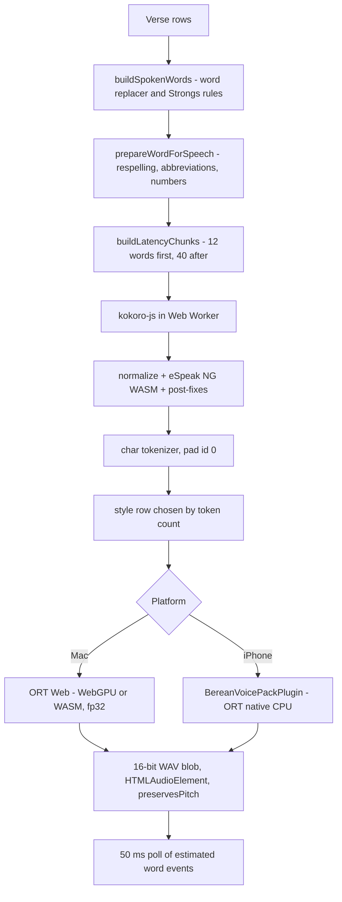

# 09 - Native Component Replacements

> **Baseline note.** Investigated at `807c2d9`. The final baseline is `d97fb05`. The only code changes between them are PRs #9, #10 and #11, listed in `01-REPOSITORY-STABILIZATION.md`: fixes for sync defects D1-D4, note table-cell formatting, and audio cache keys. Anything below describing those defects as present is corrected where noted.

Audit of commit `807c2d974b795f95f4c05b8ae4b6796c273b572c`, 2026-11-05. Xcode 27.2 (27B52), iOS 27.2 SDK, deployment target iOS 17 today. Read-only on the code. This document describes what a migration to fully native Swift would involve. **It does not recommend implementing anything now.** Companion to `02-CURRENT-ARCHITECTURE.md` and `14-DEPENDENCY-AND-CODE-MAP.md`.

**Labels.** **VERIFIED**: read in this repo, read in the installed SDK headers, or measured here. **INFERRED**: follows from verified facts, not executed. **UNVERIFIED**: comes from a third party or from memory and was not reproduced here. **BLOCKED**: cannot be checked under the audit rules (no app builds, no dev server, no physical device).

**Effort classes** are for one experienced Swift engineer and are all INFERRED judgement, not estimates backed by data: **S** up to 1 week, **M** 1-4 weeks, **L** 1-3 months, **XL** more than 3 months.

**How evidence was gathered.**

- Code read directly at the audit commit.
- Apple API claims checked against the Xcode 27.2 SDK headers and `.swiftinterface` files, and the local Xcode documentation index.
- The real `phonemizer` package was executed in Node from a scratch directory on Bible text and on the divine names. No app code ran.
- The already-downloaded Kokoro `model.onnx` and `tokenizer.json` in the Berean Dev support folder were read as files (protobuf scan). Nothing was downloaded. No inference ran.
- Web sources were read through a summarising fetch, so anything from them is a paraphrase unless marked. Project README benchmarks are the projects' own claims and were not reproduced. They stay UNVERIFIED however precise they look.
- User notes were **not** opened. No claim here rests on the content of Michael's notes.

---

## 0. Summary of conclusions

| Question | Conclusion | Label |
|---|---|---|
| Can SwiftUI `TextEditor` be the notes editor? | No. It is iOS 26+/macOS 26+, and nothing in its API or docs offers attachments, tables, block views or custom block layout | VERIFIED for API surface, INFERRED for the verdict |
| Is a native notes editor feasible? | Yes, as custom engineering on TextKit 2. No off-the-shelf component covers it. Full parity is XL and is the largest single item in the migration | INFERRED |
| What gates the editor? | A byte-stable Swift Markdown engine, not the text view. It can be proved with no UI by differential testing against the current TypeScript parser and serializer | INFERRED |
| Does `swift-markdown` / cmark-gfm solve Markdown? | No. This corrects doc 14. Notes rely on markdown-it behaviours cmark cannot be configured to match | VERIFIED for current behaviour, INFERRED for the mismatch |
| Is native Read Aloud feasible with the same voices? | Very likely. The model already runs through ONNX Runtime in Swift. What remains is a Swift text-to-token path, native audio, and proof on a real iPhone | INFERRED |
| What does the iPhone plugin prove? | Only that ids + style + speed go through `model.onnx` on CPU and return PCM. Speed is simulator-only. Memory, device performance, locked-screen behaviour are unproven | VERIFIED (scope), UNVERIFIED (device) |
| Is the Neural Engine the answer? | Not for screen-locked reading by default. Apple's iOS 27 docs say any Neural Engine access in the background needs the Background Inference entitlement. CPU has no such rule stated | VERIFIED (doc text), UNVERIFIED (behaviour with audio background mode) |
| Is eSpeak a licensing problem? | Probably already, not only after migration. `phonemizer` declares Apache-2.0 but embeds eSpeak NG, which is GPLv3+. It is reachable from both shipping apps. Needs legal review | VERIFIED (facts), INFERRED (exposure) |

Three findings that change what earlier documents say:

1. **Raw Markdown mode no longer exists.** `Cmd+Shift+M` toggles Edit/View. See section 2.2.
2. **Table cells lost inline formatting on save.** Fixed at `d97fb05` (PR #10). See section 2.3.
3. **The `Yeshua` respelling almost certainly does not make the intended sound.** eSpeak produces `jˈɛshjuːwə` with separate `s` and `h`, not `ʃ`. See section 3.3.

---

# Part 1. Technology mapping

Risk means risk to product behaviour or data if replaced, not difficulty alone. Doc 14 has the full per-package inventory. This table groups the 65 declared packages plus the transitive ones that matter and adds reasoning.

## 1.1 Runtime and shell

| Existing | Proposed native | Why | Effort | Risk | Label |
|---|---|---|---|---|---|
| Electron 32 main process (`electron/main.ts`, 295 IPC handles, 9 window kinds) | AppKit app lifecycle with SwiftUI scenes. `NSWindow`/`NSWindowController` for presenter, Study Trail, chat, verse picker, floating tab | SwiftUI `WindowGroup` alone is a poor fit for nine window roles with cross-window state. The IPC layer disappears, services become direct calls | XL | High | INFERRED |
| `electron/preload.ts`, `src/types/electron.d.ts` | Swift protocols per domain, one per namespace | `electron.d.ts` (1,111 lines) is the best inventory of the service surface; keep as the contract spec | M | Low | VERIFIED as inventory |
| Capacitor 8 + `BereanBridgeViewController` + 13 `@capacitor/*` | Remove. Plain SwiftUI app; the 14 first-party plugins lose their `CAPPlugin` wrapper and become services | Plugin bodies are already Swift. `SQLiteConnection.swift`, cloud, Spotlight, share and print logic carry over | L | Medium | VERIFIED that plugins are thin wrappers for most methods |
| React 18, react-dom (323 files) | SwiftUI, with AppKit/UIKit where SwiftUI is weak: text, large lists, multi-window, the verse reader | The reader (`BiblePanel` 4,382, `VerseRow` 2,155 lines) needs per-word hit testing, selection, highlights and inline Strong's chips. That is a text-engine problem shared with Part 2 | XL | High | INFERRED |
| Zustand `useAppStore` (3,808 lines) + `studyTrailSlice` | `@Observable` domain stores, not one global object. Persistence semantics stay as they are | Doc 14 suggested SwiftData. **Not recommended here**: the 49-version SQLite schema and iCloud journal are the spec, a second persistence model adds a migration with no benefit. Three overlapping persistence layers (doc 02 section 7) should collapse to SQLite + `UserDefaults` | L | Medium | INFERRED |
| `src/platform/services` (24 files, 6,315 lines) | Swift services over a Swift `Database` protocol | SQL and rules port directly. `importBoundaries.test.ts` already guarantees no Node or Electron imports, so the logic is portable | L | Medium | VERIFIED boundary |
| `src/platform/sync` | Swift port that preserves `SYNC_FORMAT_VERSION` | On-disk iCloud journal is an interop contract while any TypeScript client survives | L | **High** (data) | Doc 14 |
| `electron/ipc/aiLookup.ts` (4,156 lines), `src/lib/research` | Swift port. Densest business rules, not shared with iPhone today | Port with `retrievalFixtures.ts` as acceptance data | L | Medium | Doc 14 |
| Pure logic in `src/lib` (`parseRef.ts` 1,054, `noteTextBlocks.ts` 512, `tagRefScan.ts`, `wordReplacer.ts`, TTS prep) | Swift ports driven by exported JSON test vectors from the Vitest suites | The editor's reference detection and Read Aloud both depend on these, so port them first | M | Medium | VERIFIED dependency |
| Vitest (384 files, about 4,555 cases) | Swift Testing + golden fixtures generated from TypeScript | Best executable spec in the project | L | Low | Doc 14 |

## 1.2 Data and files

| Existing | Proposed native | Why | Effort | Risk | Label |
|---|---|---|---|---|---|
| better-sqlite3 | Direct `sqlite3` via the existing `SQLiteConnection.swift`, or GRDB.swift 7.x (MIT, FTS5, release 7.12.0 on 2026-11-01) | Schema includes FTS5. See doc 04 for the DB. GRDB gives observation and migrations, the raw wrapper gives fewer dependencies. GRDB needs Swift 6.1+ tooling, which Xcode 27 satisfies | M | Medium | GRDB facts UNVERIFIED beyond README |
| Native Node addons (`native/mac-liquid-glass/berean_glass.m`, `native/mac-icloud/berean_icloud.m`) | Delete. Liquid Glass comes from SwiftUI/AppKit directly, iCloud from `FileManager`/`NSFileCoordinator` | 451 lines of ObjC exist only to reach APIs a native app calls directly | S | Low | VERIFIED |
| `onnxruntime-node`, `sharp` (transitive, optional) | Remove | No first-party import | S | Low | Doc 14 |
| `chokidar` 3.6 (undeclared, arrives through tailwindcss; polling at 1.5 s, depth 10) | `DispatchSource`/FSEvents plus `NSFilePresenter` for iCloud-coordinated paths | Native removes a polling watcher and an undeclared-dependency fragility. Dataless iCloud files need care: synchronous reads hung the Mac before (memory note on the 2026-09-22 freeze) | M | Medium | VERIFIED polling in `electron/ipc/vault.ts`:782, :836 |
| `electron/ipc/vault.ts` (1,449 lines) | Swift port. Keep the file format exactly | Octarine/Obsidian compatibility is a data contract: frontmatter, `color:` emoji, `==🟡text==`, attachments extraction | L | **High** (data) | VERIFIED |
| `electron-log` | `os.Logger` | Direct replacement | S | Low | Doc 14 |
| Electron `safeStorage` (`secrets/providerKeys.ts`) | Keychain | Existing encrypted keys must be migrated or re-entered; they cannot be decrypted outside Electron's scheme without a one-time bridge | S | Medium | INFERRED |

## 1.3 UI technology

| Existing | Proposed native | Why | Effort | Risk | Label |
|---|---|---|---|---|---|
| react-mosaic-component | Custom recursive split layout: `NSSplitView` on Mac; iPhone has no tiling | `HSplitView` cannot express a persisted binary tree of draggable panes. `workspaces.layout_json` stores mosaic JSON, so a mapper is required | M | Medium | VERIFIED storage, INFERRED verdict |
| Tailwind + `global.css` tokens (`docs/design-system.md`, `src/styles`) | Asset-catalog colours, a `Theme` value type, semantic SwiftUI styles | Tokens carry over; utility classes do not. Much of the 7,068 lines of CSS imitates native chrome and simply goes away. 19 theme presets and the 15-colour highlight palette are real product data | M | Low | VERIFIED palette |
| `src/platform/liquidGlass`, `glass.css` | System glass materials | Replacement is the platform itself | S | Low | INFERRED |
| framer-motion (31 files) | SwiftUI animation, `matchedGeometryEffect`, `PhaseAnimator`, system transitions | Most uses become default system motion | M | Low | INFERRED |
| lucide-react (211 files) | SF Symbols. Custom symbols for gaps. `SFIcon.tsx` has a partial map | Visual-only | S | Low | Doc 14 |
| Radix popover, dialog, tooltip | `.popover`, `.sheet`, `.help`, `Menu` | Direct | S | Low | Doc 14 |
| `@tanstack/react-virtual` | `List`, `NSTableView`, `UICollectionView` | Native lists virtualise by default | S | Low | Doc 14 |
| `diff` (note version history) | Port of word diff, or a small Myers implementation. `CollectionDifference` works on tokens | Exact output need not match; history UI is display only | S | Low | INFERRED |
| `marked` (note preview, print) | Reuse the Swift Markdown engine from Part 2 | One parser instead of the current three (`marked`, markdown-it for chat, PM parser). `NoteVersionHistory.tsx` still uses `marked` on purpose for diff markers | M | Low | VERIFIED |
| `markdown-it`, `prosemirror-markdown` | **Custom Swift Markdown engine**, not swift-markdown. See section 2.3 | This corrects doc 14 | L | **High** (data) | INFERRED |
| 12 ProseMirror packages | Custom document model + TextKit 2. See Part 2 | | XL | **High** | INFERRED |
| Berean Chat composer (`ailookup/composer/chatEditorState.ts`) | Small editor on the same engine. Plain `UITextView`/`NSTextView` with Markdown shortcuts may be enough | Uses the notes schema, but message content is Markdown with narrower needs. Note its serializer differs: hard breaks are bare newlines and unformatted text stays literal | M | Low | VERIFIED |
| `pdfjs-dist` 4.10 | PDFKit: `PDFView`, `PDFAnnotation`, `PDFSelection`, find | Mature on both platforms. **Stored highlights are `rects_json` normalised to page plus `text`** (`pdf_highlights`, `PDFViewer.tsx`:37). They are geometry from the pdf.js text layer. Page-normalised rects should map after a coordinate flip, but rects from pdf.js and PDFKit selections will not coincide exactly, and rotated or cropped pages need a test | M | Medium | VERIFIED storage, INFERRED mapping |
| YouTube `<webview>`, Mac (`YouTubeTab.tsx`, 2,763 lines, partition `persist:youtube`, heavy `executeJavaScript`/`insertCSS`) | `WKWebView` with `WKWebsiteDataStore`. **This remains a web view permanently**: no native YouTube player exists | Replacement is Electron webview to WKWebView, not web to native. Injected scripts need reworking through `WKUserScript`. Logged-in state does not migrate. Auto-PiP via `requestPictureInPicture` needs retesting, since Chromium's `<video>` PiP and WebKit's are separate implementations | L | Medium | VERIFIED existing behaviour, INFERRED WebKit outcome |
| YouTube, iPhone (`BereanWebViewPlugin.swift`, `TouchYouTubePlayer.tsx`) | Keep the WKWebView wrapper; lift it out of the plugin | Already native-hosted. Must keep the https `baseURL`: without it YouTube's embed returns error 153. YouTube policy III.I.9 bars features playing from a background player and III.I.7 bars separating audio from video, so a native rebuild cannot "improve" this with audio extraction | M | Medium | VERIFIED code; policy per Google page |
| Print and PDF hidden windows (`app:printNote`, `exportNotePDF`) | `UIPrintPageRenderer`/`NSPrintOperation` from a native renderer, PDFKit or Core Graphics for export | `staticRender.ts` output is HTML and CSS today. A native renderer must exist anyway (section 2.6) | M | Medium | INFERRED |
| `suncalc` | Small Swift port of the sunrise calculation | Daily-note boundary. Test against suncalc values | S | Low | Doc 14 |

## 1.4 Update, packaging, tooling

| Existing | Proposed native | Why | Effort | Risk | Label |
|---|---|---|---|---|---|
| electron-updater (GitHub Releases, beta channel) | Sparkle 2 (MIT family, 2.10.1 on 25 Oct) for Developer ID; App Store for MAS and iOS | Standard. Existing Electron installs need one final bridging update | M | Medium | Sparkle facts per README |
| electron-builder, `@electron/notarize` | Xcode archive, `xcodebuild -exportArchive`, `notarytool`, `hdiutil` | `verify-mas.mjs` logic survives | M | Low | Doc 14 |
| electron-vite, vite, eslint, typescript, postcss, autoprefixer, `@electron/rebuild`, `@electron-toolkit/utils`, `@types/*`, jsdom | Remove | Replaced by Xcode and Swift tooling | S | Low | Doc 14 |
| Windows NSIS job in `release.yml` | **No native Swift equivalent.** Product decision needed: drop Windows, or keep Electron for it | A Swift-only codebase ends Windows support | n/a | **High** (product) | VERIFIED job exists |

## 1.5 AI and machine learning

| Existing | Proposed native | Why | Effort | Risk | Label |
|---|---|---|---|---|---|
| Ollama (`electron/ollama.ts`, `localhost:11434`) | Keep as an HTTP client through `URLSession` on Mac. It is a separate app, not embedded. iPhone has no equivalent. Optional later: MLX Swift (MIT, 0.33.0) or Foundation Models | Ollama is unaffected by the UI technology. Foundation Models quality for scripture retrieval is unknown and Apple's page could not be read | S | Low | VERIFIED code; alternatives UNVERIFIED |
| Cloud providers (`src/lib/research/providers`, `modelGateway.ts`) | `URLSession` client plus Keychain | Plain HTTPS | S | Low | INFERRED |
| Embeddings: `nomic-embed-text` via Ollama at query time; prebuilt int8 index (`verse_embeddings.db`, 768 dimensions, brute-force cosine) | Index file unchanged. Dot product through Accelerate. Query embedding stays on Ollama on Mac. For iPhone, a Core ML or ONNX conversion of the **same** model is required, because vectors from another model are meaningless against this index (`electron/embeddings.ts` header) | `NLContextualEmbedding` cannot query this index without rebuilding it, and the index's recall is already modest (recall@5 26.7% on the build script's comparison). A model swap needs an eval run | M | Medium | VERIFIED |
| `kokoro-js` 1.2.1 | Swift text-to-token path + ORT or Core ML. Part 3 | | L | **High** | INFERRED |
| `@huggingface/transformers` 3.8.1 | Remove. Used here only for `AutoTokenizer`, `env` and `RawAudio`. The Kokoro tokenizer is a 115-entry character map | Trivial in Swift (section 3.2) | S | Low | VERIFIED |
| `onnxruntime-web` 1.22-dev + 21.6 MB WASM download | Remove. ORT native takes over on Mac too. Package declares `.macOS(.v14)` | Removes the WASM download and `primeOfflineWasmRuntime` | S | Low | VERIFIED `Package.swift` in local SPM checkout |
| `onnxruntime` Swift 1.24.2 | Keep and widen to macOS | Already linked in the iPhone app. `BereanNative/Package.swift` is `.iOS` only and imports Capacitor and UIKit, so the inference code must be lifted out | S | Low | VERIFIED |
| `berean-model://` scheme (`ttsModelProtocol.ts`), `ttsModel.ts`, `modelDownloader.ts` | Delete the scheme; files are read directly. Reuse the staged download design in `BereanVoicePackPlugin` for both platforms | Plugin downloader is already native and sound: temp folder, manifest last, excluded from backup | S | Low | VERIFIED |
| AVSpeechSynthesizer (`BereanSpeechPlugin`) | Not a replacement for Kokoro. See 3.1 | Michael rejected system voices | n/a | n/a | VERIFIED |

---

# Part 2. Native text editor feasibility

## 2.1 What exists

`src/components/notes/pm`: 39 source files, 11,743 lines including 1,214 of CSS, plus 41 test files of 4,756 lines. `NoteEditorPM.tsx` is 1,587 lines. VERIFIED. It serves the Mac note panel, the side-panel note, and the iPhone full-page and verse-sheet editors (`src/mobile/notes/*`). Read-only surfaces go through `staticRender.ts`: version history, daily scroll, Presenter, print/PDF.

Persistence is **Markdown text** in `notes.content`, indexed by `notes_fts`, stored in `note_versions`, carried in the iCloud journal, and mirrored to the vault. The document model is transient. The string is the contract. VERIFIED.

### Schema (`schema.ts`)

| Node | Attrs | Content | Stored Markdown |
|---|---|---|---|
| `doc` | | `block+` | |
| `paragraph` | `indent` 0-8 | `inline*` | Leading NBSP run, 4 per level |
| `blockquote` | | `block+` | `> ` |
| `callout` | `calloutType` NOTE, TIP, WARNING, IMPORTANT, CAUTION | `block+` | `> [!TYPE] ...` |
| `column_list` / `column` | | `column{2,}` / `block+` | `<!-- berean:columns -->`, `<!-- berean:col -->` and closers, on their own lines |
| `thread` | `threadId`, `title` | `thread_entry+` | `<!-- berean:thread id="" title="" -->` |
| `thread_entry` | `entryId`, `createdAt` | `block+` | `<!-- berean:thread-entry id="" created="" -->` |
| `study_trail_embed` | `trailSessionId`, `title`, `connectionCount`, `needsInputCount` | leaf | `<!-- berean:study-trail ... -->`, one line |
| `heading` | `level` 1-6 | `inline*` | ATX |
| `code_block` | `params` | `text*`, no marks | Fenced |
| `horizontal_rule` | | leaf | `---` |
| `image` (**inline**) | `src`, `alt`, `title`, `width` | leaf | `` |
| `hard_break` | | inline | `\` + newline |
| `bullet_list` | `tight`, `marker` (- * +) | `list_item+` | Marker preserved |
| `ordered_list` | `order`, `tight` | `list_item+` | |
| `list_item` | `checked` null/true/false | `paragraph block*` | `[x] ` / `[ ] ` prefix |
| `table`, `table_row`, `table_header`, `table_cell` | `alignment`, plus prosemirror-tables' span and width attrs | cells `inline*` | GFM pipe table |

Containers nest: threads inside columns, columns inside thread entries, columns inside columns. `splitColumns` and `skipOpaqueForeignBlock` in `parser.ts` handle this with depth tracking. VERIFIED.

**Marks, in schema order** (order fixes nesting in the output): `em`, `strong`, `code` (excludes all others), `strike`, `underline` (`<u>`), `highlight` (`==x==` or `<mark class="hl-COLOR">`, 15 colours), `link`, `wikilink` (`[[Title]]`, `[[Title|alias]]`).

### Things that look like nodes but are not

These are decorations computed from plain paragraphs. They never reach the Markdown, which is why the round trip holds, and why a native model must also keep them derived:

| Feature | File | Behaviour |
|---|---|---|
| Verse blocks | `blockDecorations.ts` | Runs of top-level paragraphs matched against `SINGLE_VERSE_LINE_RE`, then **asynchronously checked against real Bible text** (`verseTextAccepted`, `window.bible.queryChapter`) with a threshold, then styled as one rounded block across paragraph boundaries |
| Lexicon blocks | `blockDecorations.ts` | `LEXICON_BLOCK_HEADER_RE`, multi-paragraph |
| Inline verse refs | `refDecorations.ts`, `findVerseRefMatches`, `parseRef` | Regex scans, incremental up to `INCREMENTAL_MAX_BLOCKS = 40`. Click navigates, hover previews, context menu |
| `lxx:` refs, Strong's `H1234` | `refDecorations.ts` | `LXX_PREFIX_RE`, `LEXICON_REF_RE` |
| `#tag` chips | `tagRefScan.ts` | Greedy match against known tags, including multi-word tags, with colour slots |
| Suppressed refs (`Cmd+Shift+R`) | `suppressRanges.ts` | Position ranges, in-memory only, cleared at restart |
| Heading collapse | `headingCollapse.ts` | Plugin state; persisted in `note_heading_collapse` by `computeHeadingKey` (level + text + ordinal), not in Markdown |
| Thread collapse | `threadCollapse.ts` | Persisted by `threadId` |
| Code highlighting | `codeBlockHighlight.ts` | Hand-rolled regex for 7 language families |
| Find highlights | `findHighlight.ts` | Modes phrase, all, any |
| Placeholder, title line, selection stats, word count | various | |

### Behaviours requested for study

| Item | Actual state | Label |
|---|---|---|
| Underline | `<u>…</u>`, parsed by a narrow custom rule because `html: false` | VERIFIED |
| Emoji highlight | **No such construct in the editor.** Colour highlights use `<mark class="hl-*">`. `==🟡text==` is produced only by `applyHighlightMarkdown` in `electron/ipc/vault.ts`:358 for verse text in vault exports, and Octarine's `color:` field uses emoji. If that text reaches the editor it is a plain highlight whose text begins with an emoji | VERIFIED |
| Wikilinks | Mark with `title`. Serializer writes `[[Title]]`, or the alias form if text differs. Input rule, autocomplete, hover, click. Not parsed for nested inline. Note links created by the link editor are `berean://note/<id>` `link` marks instead (`linkModel.ts`) | VERIFIED |
| Scripture linking | Decoration only. Stored text stays plain, e.g. `Gen 1:1`. Never a mark | VERIFIED |
| Tables | prosemirror-tables: cell selection, column resize, Tab navigation. Toolbar adds row below and deletes row, column, table. Column widths are not in Markdown. Merged cells cannot round trip | VERIFIED |
| Images | Inline node. Paste, drop, picker. Stored as **base64 data URL inside Markdown**, extracted to `{vault}/attachments/` only on export. Width-only resize on selection, written as `\|wNNN`. Hover capsule: copy, download, delete | VERIFIED |
| Slash commands | Trigger in `autocomplete.ts`; basic blocks, callouts, image, table, columns, thread, divider | VERIFIED |
| Block handles | Top-level blocks and list items, grip selects the block as `NodeSelection`, drag reorders via PM's drop handling, block menu. **Off on iPhone** after it was 74% of a long note's DOM (5,222 of 7,066 nodes) | VERIFIED |
| Code blocks | NodeView header with language picker and copy. `params` round trips | VERIFIED |
| Autosave | `onChange` emits Markdown on **every** doc-changing transaction: `dispatchTransaction` runs `serializeToMarkdown` on the whole document. 500 ms debounced save, title and content merged in `pendingSaveRef`, flushed on note switch and window close, version snapshot after 2 idle minutes. iPhone equivalent in `useNoteAutosave.ts`, plus flush on background | VERIFIED |
| External change guard | Own outputs recognised as echoes (`emittedRef`), composition never interrupted, external content handed back as a version, trailing-whitespace-only difference ignored | VERIFIED |
| Undo | `prosemirror-history`. Native Format and undo input events routed to PM | VERIFIED |
| Paste | Image item inserts base64; bare URL becomes a link; `transformPasted` recloses wrappers; duplicate-paste guard for Raycast within 500 ms; otherwise PM's HTML/text clipboard parser using schema `parseDOM` | VERIFIED |
| Text input | `beforeinput` workarounds: OS text replacement, autocorrect `insertReplacementText` via `dataTransfer`, surrogate pair delete, separate iOS path. All WebKit/Chromium-specific. A native text view deletes this whole class of bug | VERIFIED |
| Input rules | `#`, ` ``` `, `>`, lists, `[ ]`, `---`, `**`, `__`, `*`, `_`, `~~`, `` ` ``, `==`, `[[`, em dash | VERIFIED |
| Keys | `Mod-b/i/u`, `` Mod-` ``, `Mod-Shift-h`, undo/redo, Tab and Shift-Tab (table, list, indent, code), Enter, Shift-Enter, `Mod-Shift-Arrow` moves top-level block, Escape selects block | VERIFIED |

## 2.2 Raw mode: the spec is stale

`NoteEditorPM.tsx`:105 says `mode?: 'edit' | 'view' // replaces previewMode + wysiwyg (raw mode dropped)`. `NotesPanel.tsx`:745 maps `berean:toggleMarkdown` to Edit/View. CLAUDE.md section 9 and `Onboarding.tsx`:224 ("Toggle raw markdown / rendered view") are out of date. VERIFIED.

So a native editor does **not** need to reproduce raw mode. Keeping a read-only source view would be cheap and useful as a safety valve, but it would be a new feature. Decision for Michael.

## 2.3 Markdown round trip: what must be reproduced

The current behaviour, read from `markdownIt.ts`, `parser.ts`, `serializer.ts`, and `prosemirror-markdown`:

**Parser settings**

- markdown-it `default` preset, `html: false`, `breaks: true`, GFM tables, strikethrough.
- `md.disable('code')`: no indented code blocks, because e-Sword imports start paragraphs with a tab.
- Custom inline rules for `[[…]]`, `==…==`, `<mark class="hl-*">…</mark>`, `<u>…</u>`. Highlight and underline re-tokenize their contents.
- Custom core rule for task items.
- `validateLink` widened to allow `data:image/svg+xml`. Remove this and SVG images vanish on reparse.
- Raw HTML otherwise stays literal text.

**Pre-processing before markdown-it**

- Fence-aware line scans extract threads, columns and study-trail embeds into private-use placeholders, and recursively parse their contents.
- Malformed markers stay as literal text on purpose. No content loss.
- `\n{3,}` becomes zero-width-space paragraphs outside fences, turned back into empty paragraphs afterwards.

**Post-processing**

- NBSP run to `paragraph.indent`.
- Blockquote with `[!TYPE]` to `callout`, with the marker stripped.

**Serializer specifics**

- `tightLists: true`, original bullet marker preserved.
- Empty paragraphs become extra blank lines; a trailing empty paragraph emits the U+200B sentinel. An entirely blank note stays an empty string.
- Single `\n` in stored text parses to `hard_break` and is written back as `\` + newline (`hard_break`, `prosemirror-markdown` dist line 462). A trailing run of hard breaks writes nothing. So old notes normalise on first edit.
- prosemirror-markdown's escaping (`state.esc`) and its mark open/close ordering with `mixable` and `expelEnclosingWhitespace` determine exact bytes.

**Data-loss behaviour that exists today**

- **Table cells flattened formatting (fixed by PR #10; notes saved before the fix have already lost it).** `table()` in `serializer.ts` wrote `cell.textContent`. The parser accepts inline formatting in cells (`**x**` becomes a mark), but saving drops it: bold, links, highlights, wikilink brackets, and images in cells are all lost on any save of that note. INFERRED from reading both sides. The round-trip test only covers plain cells (`roundtrip.test.ts`:157). Native work must decide whether to fix this or reproduce it. Fixing it is safe for existing notes, and the live editor currently shows formatting that then disappears.
- Trailing spaces at line ends do not survive (acknowledged in `NoteEditorPM.tsx`).
- Hand-aligned table spacing is normalised, by design.
- `<!-- -->` thread markers rely on exact line form. Mid-line markers stay literal.
- Heading collapse keys change when heading text changes.

Round-trip history matters: the migration comments record 448 of 3,325 notes mismatching structurally during the CodeMirror to ProseMirror move, mostly from `breaks`. `noteMigration.ts` normalised notes opt-in, keeping `pre-migration` versions. So some notes may never have been normalised. A new engine will meet both forms. VERIFIED from comments; the current corpus state is unknown.

**Why swift-markdown is the wrong base.** It wraps cmark-gfm (per its README). INFERRED mismatches, each from the settings above:

| Current behaviour | cmark-gfm via swift-markdown |
|---|---|
| Indented code disabled | No switch; a tab-indented paragraph becomes a code block. This is the e-Sword case |
| `html: false`, literal HTML | Produces HTML block and inline nodes. `<!-- … -->`, `<div>` and `<u>` need re-interpretation and source recovery |
| `==`, `[[ ]]`, `<u>`, `<mark>` rules | Needs C-level extensions, which swift-markdown does not expose in its public API (UNVERIFIED beyond README); or a second inline pass that fights emphasis precedence |
| Emphasis/link edge cases | CommonMark-conformant, but both parsers' extension interactions differ, and notes contain pipes, brackets and `*` from Scripture and pasted text |
| Serializer | `MarkupFormatter` is a separate design; it would not match prosemirror-markdown bytes |

`AttributedString(markdown:)` is further away: no block model suited to this schema.

**Conclusion.** Write a Swift port of the exact subset: markdown-it's block and inline rules in use, the custom rules, and prosemirror-markdown's serializer. That is a few thousand lines of well-specified code with a perfect oracle. Effort L. INFERRED.

The acceptance test, which needs no UI:

1. For every real note, `swift(serialize(parse(x)))` equals `ts(serialize(parse(x)))` byte for byte.
2. Document trees match node for node.
3. Run the same on fuzzed Markdown and the 30 cases in `roundtrip.test.ts`, plus `threads`, `columns`, `studyTrailEmbed`, and `trailingSpaceRoundTrip` tests.

Fidelity then stops being a judgement call. Any native editor option depends on this engine, so it comes first whichever option wins.

## 2.4 Apple text technologies

### SwiftUI TextEditor

VERIFIED from the iOS 27.2 SwiftUI interface and Xcode documentation:

- `TextEditor(text: Binding<AttributedString>, selection: Binding<AttributedTextSelection>?)` is `@available(iOS 26.0, macOS 26.0, visionOS 26.0, *)`. Deployment target is iOS 17.
- `AttributedTextSelection` supports multiple ranges (`RangeSet`). `AttributedString` gains `transform(updating:)`, `transformAttributes(in:)`, `replaceSelection`.
- `AttributedTextFormattingDefinition` and `AttributedTextValueConstraint` constrain what values attributes may take. Custom attribute scopes are allowed.
- `AttributedTextFormatting.Transferable` supports RTF and RTFD.
- I found no new `TextEditor` API marked for iOS 27 in the interface grep.
- WWDC25 session 280 lists font, colour, underline, strikethrough, kerning, tracking, baseline offset, Genmoji and paragraph styling. No attachments, tables or custom views appear in it, in the Xcode docs search, or in the interface.

Consequences. INFERRED:

| Need | Result |
|---|---|
| Inline images with resize | Not available. Only `adaptiveImageGlyph` |
| Tables, columns, threads, callout chrome, checkboxes, code header | Not available: no block or view hook |
| Custom drawing (verse block rectangles, pills) | Not available |
| Hit-testing a verse ref or tag, hover cards | No per-range tap or hover API seen |
| Key handling for Tab, Enter, Escape, slash menus at caret | Weak: no caret rect API seen |
| Long notes | Binding copies an `AttributedString`; behaviour on large documents unmeasured |

Verdict: **unsuitable for notes.** Plausible for small fields. Also forces iOS 26.

### UITextView and NSTextView on TextKit 2

VERIFIED in the 27.2 SDK:

- `NSTextLayoutManager`, `NSTextContentManager`, `NSTextElement`, `NSTextLayoutFragment`, `NSTextViewportLayoutController`, `NSTextSelection`, `NSTextSelectionNavigation`, `NSTextListElement` are in UIKit and AppKit.
- `NSTextContentManagerDelegate textContentManager:shouldEnumerateTextElement:options:` can skip elements: the supported route to folding headings and threads without deleting text.
- `textContentManager:textElementAtLocation:` allows custom elements.
- `NSTextAttachmentViewProvider` and the `NSTextAttachmentLayout` protocol allow live views in text (iOS 15, macOS 12).
- **New in iOS 27:** `UITextView` declares `NSTextViewportLayoutControllerDelegate` conformance with overridable viewport methods (`configureRenderingSurfaceForTextLayoutFragment`, `viewportBoundsFor…`, will/did layout), and `registerTextAttachmentViewProviderReusePolicy:`. Reuse policy matters for documents with many images.
- `UITextView.selectedRanges` and `shouldChangeTextInRanges:` are iOS 26.
- **`NSTextTable.h` is in the iOS 27.2 UIKit headers**, with `NSTextBlock`, `NSTextTableBlock`, `NSParagraphStyle.textBlocks`. Class-level availability is annotated `ios(6.0)`, and per-edge border APIs are marked `ios(27.0)`, `macos(27.0)`.

**That last point is the most significant Apple-side unknown.** It contradicts the usual statement that iOS has no text tables. Whether a TextKit 2 `UITextView` lays out and edits these tables is not stated in any header. Third-party guidance says NSTextTable is TextKit 1 only and that using it drops an `NSTextView` to compatibility mode (SECONDARY, and it predates this SDK). Apple's NSTextTable page could not be read. The header itself does not mention `NSLayoutManager` dependence beyond a forward declaration. Treat as **BLOCKED** until a small test runs. A cell in `NSTextTable` also holds paragraphs in one text flow, which would give real cross-cell selection, so it is worth a day.

AppKit and UIKit are separate hosts. `NSTextView` and `UITextView` share the layout classes but not the view, selection, menu, drag or input code, so the document model and projection can be shared and the host cannot. `NSTextView` is the more complete of the two on the Mac, with long-standing text-table and ruler support under TextKit 1. INFERRED.

TextKit 2 reliability: Krzyzanowski's "TextKit 2: The Promised Land" (via a repost dated 2025-08-15, updated 2026-03-26) and Simon Støvring's reply describe performance and correctness problems and a large workaround burden. STTextView's README lists about two dozen reported Apple bugs. All SECONDARY, and none tested on the iOS 27 additions. The risk is real but not measured on this SDK.

### TextKit 1

`NSLayoutManager`, stable, with a known non-viewport cost on long documents. Accessing `.layoutManager` on a text view switches it to TextKit 1 irreversibly per the same SECONDARY source. Could be a fallback for Mac tables through `NSTextTable`, but then the two platforms diverge. Writing Tools and other newer features favour TextKit 2 (UNVERIFIED).

### Custom text view on `UITextInput` / `NSTextInputClient`

Own view, own layout through TextKit 2 layout objects or Core Text. Maximum control and a single-flow document with custom table fragments. Everything else becomes yours: marked text for IME, autocorrect, dictation, selection handles, loupe, context menu, Writing Tools, VoiceOver, and two platform implementations.

- STTextView shows it can be done on AppKit, but it is **GPL-3.0 with a commercial option**, so it cannot go into an App Store build under GPL.
- CodeEditTextView is MIT but a code editor on AppKit. Runestone is MIT, iPhone/iPad, and a code editor.

Neither is a rich block editor.

### Third-party rich editors

| Project | Licence | Fit | Label |
|---|---|---|---|
| Proton | Apache-2.0 | iOS; macOS only by Catalyst; README warns of breaking changes before 1.0. README does not mention tables or grids (memory suggests a grid view exists; not confirmed) | README read |
| Aztec (WordPress) | MPL-2.0 | iOS, HTML-oriented, no macOS mentioned | README |
| Textual, MarkdownUI | MIT | Rendering only. MarkdownUI in maintenance mode. Textual may be useful for read-only surfaces | README |

None is a basis for this editor. VERIFIED that none claims this scope.

## 2.5 Architecture options

Common to all: a Swift `Document` model (block tree, marks as ranges, stable block ids), the Markdown engine (2.3), a transaction layer with `UndoManager`, derived-decoration services (refs, tags, verse blocks) running off the main thread, and a platform view layer. The model must stay the source of truth, not the attributed string. Attributes are a projection. Marks like `wikilink` and `highlight` need custom `NSAttributedString.Key`s; the text view must never decide document structure.

### Option A: Single-flow TextKit 2 text view, with islands

One `UITextView`/`NSTextView` per note. All prose, headings, lists, quotes, callouts and code live in one text flow. Backgrounds and bars are drawn by custom `NSTextLayoutFragment` subclasses. Tables, columns, threads, trail embeds and images are attachments with `NSTextAttachmentViewProvider`. Columns and threads hold nested editors.

- **Strengths:** normal selection, IME, autocorrect, dictation, spellcheck, Find, Writing Tools and accessibility for most content. Folding via `shouldEnumerateTextElement`. Closest to Apple Notes.
- **Limits:** selection stops at an island. Copying across a table, column or thread is either a whole-island selection or custom. Nested text views need focus, undo and find routed through the parent. Threads are the worst case, because they can be most of a note, so a long thread inside one attachment defeats viewport layout.
- **Mitigation worth testing:** render threads and callouts as flat flow with indented fragments and a header element, leaving columns and tables as the only true islands. Serializer rebuilds nesting from model ids.

### Option B: Block list, one text view per block

`UICollectionView`/`NSCollectionView` of blocks, each with its own small text view. Notion-style.

- **Strengths:** tables, columns, threads, drag reorder, block menu, collapse and virtualisation are natural. Directly matches the schema. Long notes are cheap per block.
- **Limits:** selection across blocks is not native at all. Dragging a selection through paragraphs is the most ordinary thing a writer does, so it must be hand-built, with a custom selection overlay and handles on iPhone. Autocorrect, dictation and Writing Tools work per block only. Arrow-key movement between blocks is custom. VoiceOver reads per block. The verse block spanning paragraphs needs coordination. A study editor where paragraphs are typed and selected constantly would feel less native than today. Michael's measure is whether it feels like a current Apple app.

### Option C: Fully custom single-flow text engine

Custom view, `UITextInput`/`NSTextInputClient`, layout through TextKit 2 objects with custom elements for table cells and columns.

- **Strengths:** only option with true selection across everything and one coordinate space.
- **Limits:** text input, accessibility, Writing Tools and selection UI done twice. Largest long-term maintenance. Apple's input stack changes each year. Licences rule out starting from STTextView without paying.

### Option D: WKWebView editor (temporary only)

ProseMirror keeps running in a `WKWebView` inside native chrome. Native owns the note list, save, sync, toolbar, verse actions. iPhone proves this works, since that is today's architecture. Considered only because A-C were examined first, and only as a bridge. It keeps the `beforeinput` workarounds, keeps JS, and does not meet the "fully native" goal.

**Removal plan**, in order:

1. Swift Markdown engine passes differential gates; JS no longer owns the format. The web view exchanges Markdown only, through one small message interface, no `window.*` services.
2. Native read-only renderer replaces `staticRender.ts` for print, history, Presenter and view mode, so the web view is used only in edit mode.
3. Native editor opens any note whose structural scan shows only supported nodes. The web editor remains for the rest, per note, automatically.
4. Each remaining node (table, column, thread) moves native, and telemetry-free local counters plus a corpus scan show zero notes needing the web editor.
5. Delete the web view, the ProseMirror bundle and the JS bridge. Exit criterion: a release with the web editor code absent and the differential suite green. A date should be set at the start; without one a temporary editor stays.

### Assessment

**Most defensible direction for investigation: Option A with threads and callouts flattened, and tables and columns as islands.** INFERRED. If `NSTextTable` works under TextKit 2 on iOS 27 and macOS 27, tables move into the flow, leaving columns as the only island. Option B is the fallback if nested flows prove unstable. Option C only if A's selection limits are judged unacceptable and the maintenance cost is accepted.

Consequences of A that need Michael's decision:

- Selection across a table or column boundary is reduced.
- Deployment floor. A works from iOS 16 in principle, but the attachment reuse and viewport hooks are iOS 27. Raising the floor to iOS 27 / macOS 27 costs users but removes much risk. Doc 02 says deployment is iOS 17.
- Block handles on Mac are decoration over a text view: a gutter overlay computed from layout fragments. Drag reorder is a model operation. Feasible, M.

## 2.6 What needs custom engineering

Regardless of option. All INFERRED.

| Item | Class | Notes |
|---|---|---|
| Markdown engine (parser, placeholders, serializer) | L | Byte-exact oracle exists |
| Document model, transactions, position mapping | L | Replaces `prosemirror-model`, `-state`, `-transform`. Stable block ids. PM integer positions do not carry over; `tabState.cursorPos` must be remapped or dropped (`NotesPanel.tsx`:920) |
| Model to text-storage projection and incremental update | L | Hardest correctness area: edit in text view maps back to model without loss during marked text |
| Undo: grouped, spans islands, survives re-projection | M | `UndoManager` per note; must coalesce typing |
| Input rules | M | Run after text change, skip during composition and in code. 16 rules with lookbehind |
| Keyboard commands: Tab chain, Enter split, Backspace structural merges, list lift/sink | L | `baseKeymap` + `prosemirror-schema-list` behaviour is the spec; dozens of edge cases |
| Verse ref, Strong's, tag, LXX detection | M | Needs `parseRef` etc. in Swift; incremental per block; async verse verification off main |
| Verse block visual across paragraphs | M | Custom fragments with first/middle/last |
| Autocomplete popovers at caret: wikilink, Strong's, verse, slash, tag | M | Caret rect from `caretRect`/`textSegment`; iPhone keyboard handling |
| Hover cards and context menus for refs | M | `NSTrackingArea` + iPhone long-press. Mac and iPhone differ |
| Link editor, selection toolbar | M | |
| Images: attachment, async decode, width drag, copy/save/delete, base64 handling | M | **Must not hold base64 in text storage.** Model keeps source string; serialized output must reproduce it byte-exactly |
| Tables | L | See 2.7 |
| Columns | L | Nested editor, add/remove |
| Threads | L | Collapsible, timestamps, per-entry add, word counts, nesting |
| Callouts, collapsible | M | Collapse state currently local to the NodeView |
| Heading and thread collapse with persistence | M | Port `computeHeadingKey` exactly, or existing rows stop matching |
| Code block with language header and regex highlight | M | Port tables; `params` preserved |
| Task checkbox, three bullet glyph systems | S | `noteBulletStyle` setting |
| Block handles and block menu (Mac) | M | |
| Static native renderer (print, history, Presenter, daily scroll) | L | Replaces `staticRender.ts` |
| Find highlights with 3 modes, word count, selection stats | S | |
| External-change guard, autosave, flush, version snapshots | M | Port `liveNote` policy. Serialize on idle or debounce, not per keystroke as today |
| Paste: HTML import, images, URL linking, wrapper reclose | M | Today's HTML paste depends on `parseDOM`. Needs an HTML-to-model mapper, or RTF/`NSAttributedString` import, and will differ at the edges |
| Chat composer | M | |
| Accessibility for custom fragments and islands | M | Must be designed in |

Sum, for parity on both platforms: **XL. Roughly 9-15 engineer-months to reach parity with quality.** Low confidence, INFERRED, no comparable measured project here. The range is wide because TextKit 2 stability on iOS 27 is unmeasured.

Native gains, not to be undersold: the WebKit `beforeinput` workaround class disappears, real selection handles and loupe, dictation, Writing Tools (`UITextView` exposes `writingToolsCoordinator`, iOS 18.2+), native spellcheck, no DOM-size collapse on iPhone.

## 2.7 Feature risk view

Fit: **N** native or small work, **C** custom work on the API, **H** hard or fragile, **X** not possible. Compatibility risk is the risk of harming existing notes.

| Feature | TextEditor | A: flow + islands | B: blocks | C: custom | Compat. risk | Overall risk |
|---|---|---|---|---|---|---|
| Paragraphs, headings | N | N | N | C | Low | Low |
| Bold, italic, strike, underline | N | N | N | C | Low | Low |
| 15-colour highlight | C | N | N | C | Low | Low |
| Inline code | C | C | C | C | Low | Low |
| Links, wikilinks + alias | X | C | C | C | Medium: alias form | Medium |
| Scripture and tag detection | X | C | C | C | Low: derived | Medium |
| Verse/lexicon blocks | X | C | H | C | Low: derived | Medium |
| Lists, nested, task, markers, tight | H | C | C | C | **High**: bytes | High |
| Blockquote nesting | X | C | C | C | Medium | Medium |
| Callouts | X | C | C | C | Medium | Medium |
| Code block | X | C | C | C | Low | Medium |
| Inline image + resize | X | C | C | C | **High**: base64, `\|wNNN` | High |
| Table | X | H, or N if NSTextTable works | C | H | Medium | **High** |
| Columns | X | H | C | H | Medium: markers | **High** |
| Threads | X | H | C | H | Medium: ids, dates | **High** |
| Trail embed | X | C | C | C | Low | Low |
| Heading/thread collapse | X | C | N | C | Medium: keys | Medium |
| Slash and autocomplete | X | C | C | C | None | Medium |
| Block handles, drag | X | C | N | C | None | Medium |
| Selection across blocks | n/a | N in flow, H across islands | **H everywhere** | C | None | **High** |
| IME, autocorrect, dictation | N | N, care during projection | N per block | **H** | None | Medium |
| Undo | N | C | H | C | None | High |
| Long note | Unknown | Viewport; threads risk | Good | Own | None | Medium |
| Paste HTML | C | C | C | C | Medium | Medium |
| VoiceOver | N | C | C | **H** | None | Medium |
| Mac + iPhone reuse | Single | Two hosts, shared model | Two hosts | Two engines | None | High |

### Table by table operation

| Table operation (today) | Island: grid of text views | `NSTextTable` in flow (if it works) | Risk |
|---|---|---|---|
| Render GFM table with alignment | Straightforward | Straightforward | Low |
| Edit cell, Tab to next | Focus hand-off, works | Native caret movement unknown | Medium |
| Add row below, delete row/column, delete table | Model ops | Rebuild ranges | Low |
| Multi-cell selection | Custom | Unknown | High |
| Column resize drag | Custom. Widths not stored in Markdown today | Custom via block widths | Low: session-only |
| Inline formatting in a cell | Possible; see the save bug in 2.3 | Possible | Medium: decide policy |
| Copy table to other apps | Custom pasteboard | Possibly native RTF | Medium |
| Paste table | Parser path | Unknown | Medium |
| Wide table on iPhone | Horizontal scroll inside island | Unknown; likely wraps | High |
| Merge/split cells (`tableEditing`) | Omit; Markdown cannot store them | Omit | Low |
| Spell check, autocorrect in cells | Per cell | Native | Low |
| Find across cells | Parent routes | Native | Medium |

## 2.8 Long-document performance

Facts. VERIFIED: current editor serializes the whole document per doc change, computes decorations with an incremental cap of 40 blocks, and had 7,066 DOM nodes on a long note. Base64 images can make a note several MB (`noteCache.ts` comment). Note sizes in the real corpus were not read.

Native expectations. INFERRED: viewport layout should beat DOM on iPhone for plain prose, provided height estimation is stable; scroll jumps from estimated heights are a commonly reported TextKit 2 complaint, but no source fetched here states it concretely. **Not proven.** Must be measured with notes of 10k, 100k and 1M characters with images.

## 2.9 Compatibility with existing notes

| Requirement | Handling |
|---|---|
| Open any stored note unchanged | Engine gate 2.3 |
| Not rewrite on open | Serialize only after a real edit. Current editor already avoids writes without changes |
| Coexist with Electron and Capacitor clients during transition | Identical bytes prevent sync ping-pong. Even small differences would show as edits on every device |
| Vault round trip | Same frontmatter logic, unchanged |
| FTS search | Unaffected: index reads Markdown |
| Version history | Same strings |
| Heading collapse rows | Same key function |
| Thread ids | Preserved |
| Unknown or malformed markers | Stay literal, as today |
| Unrecognised HTML | Stays literal text |

## 2.10 Investigation plan for the editor

Nothing here should start without a decision. Ordered so the cheapest, most decisive checks come first.

| # | Step | Pass condition | Size |
|---|---|---|---|
| E1 | Structural-only corpus scan by a script that never prints content: counts of nodes, nesting depth, note length, image bytes, table cells with marks | Numbers known. Tells how much tables, columns and threads matter. If threads or columns are rare, the risk ranking changes | S |
| E2 | Export golden corpus: TS parser output as JSON + bytes, on a local copy | Fixture set exists | S |
| E3 | Swift engine spike: block + inline + serializer for main constructs | 100% byte match on `roundtrip.test.ts`; 99%+ on corpus with every miss explained | M |
| E4 | `NSTextTable` test under TextKit 2, iOS 27 and macOS 27: does `textLayoutManager` stay non-nil, can cells be edited | Yes/no. Decides table design | S |
| E5 | Single-flow spike: 100k-character note, custom fragments, folding by `shouldEnumerateTextElement`, 50 image attachments with reuse policy | Stable scrolling, under 16 ms typing latency on an older iPhone, no scroll jumps | M |
| E6 | Island spike: editable table and column inside text flow | Focus, undo, keyboard avoidance, VoiceOver acceptable | M |
| E7 | Marked-text stress: Japanese IME, dictation, autocorrect, text replacement during re-projection | No lost or duplicated text | S |
| E8 | Michael uses the spike for real notes for a week | He prefers it to ProseMirror | S |

Failure of E5/E6 points to Option B. Failure of both A and B points to Option D as a bridge, with the plan in 2.5.

---

# Part 3. Native Read Aloud

## 3.1 What runs today



All VERIFIED in `src/lib/tts/*`, `kokoro.worker.ts`, `kokoroBackend.ts`.

- **Engine selection.** Mac: Kokoro only, and no sound before the pack is downloaded. The `ttsEngine.ts` header says Kokoro is the only engine, but `src/platform/ios/main.tsx`:74 sets `NativeSpeechBackend` (AVSpeechSynthesizer) until Berean Voices are installed, so that comment is out of date for iPhone. Under the brief, the native plan must not substitute system voices. Whether a pre-download fallback remains on iPhone is a separate product decision, not an engine option.
- **Pack.** `onnx-community/Kokoro-82M-v1.0-ONNX`, `onnx/model.onnx` fp32 at 325,532,232 bytes, 26 listed voices, `config.json`, tokenizer files. Local dev pack: 345 MB total, 14 MB voices (28 files on disk, older pack, against 26 in `KOKORO_VOICES`). Mac adds a 21.6 MB WASM file. `docs/mobile/voices.md` and manifest comments still mention q8 at about 92 MB and "~125MB"; `modelProtocolConstants.ts` shows fp32 replaced it after **q8 produced garbled, mumbling speech**. VERIFIED. That history is a warning for fp16 and Core ML too.
- **Voice format.** `af_heart.bin` is 522,240 bytes = 510 x 256 float32. VERIFIED. `generate_from_ids` picks row `min(max(tokens - 2, 0), 509)`: the style vector depends on sequence length.
- **Model graph.** VERIFIED by protobuf scan of the local file. Inputs `input_ids`, `style`, `speed`. **Output `waveform` only.** Opset 20. 2,463 nodes, 554 initializers. Includes 6 `LSTM`, 1 `STFT`, 88 `Conv`, 6 `ConvTranspose`, 6 `Resize`, 51 `Sin`, 2 `CumSum`, 2 `Range`, `Atan`, `Round`, `Floor`.
- **Tokenizer.** VERIFIED. Character-level, 115 entries, a `Replace` normalizer deleting anything not in the phoneme alphabet, `$` id 0 on both ends, `model_max_length` 512. `ʃ` is id 131, so it is available.

## 3.2 Text to tokens: what a Swift port must include

1. `extractSpokenText.ts` and `textPrep.ts` (569 lines). Pure. Needs `taggedTokens`, `wordReplacer`. Port with test vectors. **Theologically load-bearing:** H3068/H3069 to Yehovah, H3050 to Yah, `the` blanking, name rules in `DEFAULT_WORD_REPLACER_RULES`. Spoken text must equal today's spoken text for every verse.
2. `kokoroChunking.ts`, 89 lines. `SENTENCE_END_RE` lives in `extractSpokenText.ts`.
3. kokoro-js normalizer: quote, parenthesis, number, currency and title regexes; punctuation split; `en-us` for voices starting `a`, otherwise `en`; IPA post-fixes such as `r` to `ɹ`, `x` to `k`, `ɬ` to `l`, `ʲ` to `j`. About 2 KB minified. Port as is.
4. **G2P.** The only hard part.
5. Tokenizer: dictionary lookup. S.
6. Style selection: mmap the `.bin`, slice one row. S.

## 3.3 Pronunciation customisation and what the phonemes actually are

`PRONUNCIATION_RESPELLINGS` in `textPrep.ts` respells words so eSpeak will say them correctly. It is tied to eSpeak's rules: change G2P and all tuning is void. Results from running the shipped package here, `en-us`:

| Input | Phonemes (VERIFIED) | Note |
|---|---|---|
| `Yehovah` | `jˈɛhɑːvə` | Final vowel is already schwa. The comment says this spelling over-articulates to "-vah"; the phoneme string does not show that, though the model's realisation may differ |
| `Yehovuh` (current respelling) | `jˈɛhəvˌʌ` | Middle vowel reduced to schwa; last syllable gains secondary stress and `ʌ` |
| `Yeovuh` (rejected) | `jˈoʊvʌ` | Matches the comment's diphthong failure |
| `Yeshua` | `jˈɛshjuːə` | `s` + `h` + `j`, not `ʃ` |
| `Yeshuwa` (current respelling) | `jˈɛshjuːwə` | Same. The comment marks this UNTESTED BY EAR |
| en-gb `Yehovuh` | `jˈɛhəvˌʌ` | Same |

**INFERRED: both spellings of the name are likely voiced as "yes-hyoo-wuh" rather than the intended "yesh-oo-wah".** The target from the comment is "yesh-uwa"; a spelling lever cannot easily reach it because eSpeak breaks the `sh` across a syllable in this word. Whether it sounds wrong needs Michael's ear. BLOCKED here: no audio was generated.

This shows the main native benefit. **With tokens built in Swift, a name can be given as phonemes directly**, for example a table entry `Yeshua → jˈɛʃuːə`, bypassing spelling tricks. Every symbol there is in the vocabulary (`ʃ` = 131). A user-facing pronunciation dictionary becomes possible, since word replacer rules could carry an IPA field. No code needed now; the point is that the current workaround is an artefact of the JS packaging.

## 3.4 Phonemization without eSpeak

**The licence fact.** VERIFIED: installed `phonemizer` 1.2.1 declares Apache-2.0, its README says "using eSpeak NG", and `dist/phonemizer.js` is 1.3 MB containing `eSpeakNGWorker` symbols. eSpeak NG's repository states GPL v3 or later. `kokoro.worker.ts` imports `kokoro-js`, which imports `phonemizer`. So a GPL engine is INFERRED to ship today in the Electron Mac app, the Mac App Store build, and the iPhone App Store build. The Apache label on the npm package does not settle upstream obligations. The FSF's 2010 position is that App Store terms conflict with GPL distribution (written about GPLv2; GPLv3 analysis is similar in spirit but was not reviewed). **Present risk, independent of migration. Needs a lawyer, not this audit.** No built artifact was inspected.

**Options.**

| Option | Licence | For | Against | Label |
|---|---|---|---|---|
| Linked eSpeak NG in Swift | GPLv3+ | Identical output | Not acceptable for App Store distribution without a licence nobody can grant | INFERRED |
| Closed-corpus lexicon, generated offline | Depends on origin | Berean's speech is almost entirely a fixed corpus. See measurements below | Cannot cover user word-replacer output or new texts without a fallback. Legal status of data derived from eSpeak dictionaries needs review. Safer built from CMUdict plus hand-curated names | Measured |
| CMUdict + rules + name table | CMUdict: permissive per README, acknowledgement requested. Full licence text not read | No GPL. Small | ARPAbet to Kokoro IPA mapping; no archaic forms or Biblical names, so those need curation; sounds different from today | UNVERIFIED |
| misaki via MisakiSwift | Apache-2.0 | Kokoro's own official G2P family; gold/silver dictionaries, BART fallback via MLX; POS tagging by Apple NaturalLanguage | Requires iOS 18 / macOS 15. Pulls MLX. Its dictionaries' licence needs checking. Without espeak fallback, out-of-vocabulary names rely on BART. Its phoneme conventions differ from current eSpeak output, so all voices will sound somewhat different | README claims |
| FluidAudio G2P | Repo Apache-2.0 | Core ML G2P | American English only per README; `bf_`/`bm_` voices excluded. Physical iOS "unvalidated" | README claims |

**Measurements, VERIFIED, run on the bundled texts (19 text DBs):**

- 106,188 verse rows, 2,867,887 words, **26,000 unique lowercase words**. These are the stored texts, so word-replacer output (`Yehovah` appears in none of them) is extra, and the Greek `lxx.db` is excluded.
- Whole word-to-phoneme table: about 462 KB raw. Generation took under 30 s in Node.
- Context test: 2,000 random verses, split at punctuation, `en-us`. Whole-segment eSpeak output against concatenated per-word lookups.
  - 1,664 of 8,456 segments had a different token count and were excluded, so the following is biased.
  - Of 37,892 compared words: **46.99% identical, 94.80% identical if stress marks are ignored**.
  - Differences concentrate in 229 distinct words. The top 100 (`and`, `the`, `of`, `to`, `he`, `that`, `his`, `shall`…) account for 98.6% of them, leaving 0.77% of tokens.

Meaning: most mismatch is sentence-level weak forms and stress on function words, so a word table with a function-word rule set should approach eSpeak's output on Scripture. This compares eSpeak with itself. It says nothing about how a non-eSpeak table sounds, and stress may matter a lot to prosody in Kokoro. The excluded 20% of segments is unexplained and likely includes hyphens, apostrophes and multi-token entries.

**Likely shape, INFERRED:** curated lexicon for corpus + names (built from a permissive source), function-word rules, MisakiSwift or a small rule fallback for unknown words, and direct-IPA overrides. Requires an A/B listening gate.

## 3.5 Inference options

### What `BereanVoicePackPlugin.swift` proves

| Claim | Status |
|---|---|
| ORT 1.24.2 links and ships in the iPhone target through SPM | VERIFIED in `Package.swift`, `Package.resolved` |
| `model.onnx` fp32 loads with `ORTSession`, `.all` optimisation, up to 4 intra-op threads | VERIFIED code; **ran on simulator** per `docs/mobile/voices.md` |
| Default CPU provider. No execution provider is appended | VERIFIED |
| Tensors: int64 `[1, n]`, float `[1, 256]`, float `[1]`; output `waveform`, 24 kHz | VERIFIED |
| Faster than the WASM path on the simulator: about 1.4 s to start a 6-7 s sentence, against about 5 s for 3.5 s of speech in WASM | Doc-reported, simulator on a Mac. **Says nothing about an iPhone** |
| Model released on memory warning, reloads "in about a second" | Code VERIFIED, timing UNVERIFIED |
| Staged download with manifest last, excluded from backup | VERIFIED |
| Speed on a physical iPhone | **Not proven.** The doc lists it as device-only and memory notes say the check is owed |
| Peak memory | **Not proven.** "~330 MB" is file size. Weights + arena + activations, and load-time peak, are unmeasured |
| Sustained thermal behaviour, battery | Not proven |
| Screen-locked continuous reading | Not proven. The doc says WebView JS drives each sentence, so a suspended WebView would stop it |
| Native phonemizer, tokenizer, style selection | **Not addressed.** All stay in JS |
| Native playback, word highlight, seek | Not addressed. Audio goes base64 back to JS and into `<audio>` |
| Core ML, GPU, ANE | Not addressed |
| Cancellation | None. `runOptions: nil`, serial queue, no terminate. A skip waits for the current `run` |
| Mac | Not addressed. Target imports UIKit and Capacitor |

So it proves the **inference contract and linkage**. About 70 lines of it are the seed of a native engine. It does not prove viability.

### ONNX Runtime

- Package 1.24.2, MIT, declares iOS 15 and macOS 14. VERIFIED in the local checkout.
- CoreML execution provider **is exposed**: `ort_coreml_execution_provider.h` has `appendCoreMLExecutionProviderWithOptionsV2:` with `MLComputeUnits` and `MLProgram`. VERIFIED. This fills a gap the web search could not answer.
- The ORT docs warn dynamic shapes may hurt and list op limits. With this graph's data-dependent duration expansion, partial assignment with many CPU-CoreML transitions is the likely result. INFERRED. A partitioned graph might be slower than pure CPU. Cheap to test.
- Other variants: `model_fp16` 163 MB, `model_q8f16` 86 MB, `model_uint8f16` 114 MB, `model_q4f16` 155 MB. Halves download and memory. Quality history says listen first. Comment says fp16 was only unreliable on WASM, so fp16 on native CPU has never been judged. VERIFIED comment, untested on native.
- App size: about 40 MB static library before dead-stripping (doc).
- Durations: this export offers only `waveform`. Upstream `KModelForONNX.forward` returns `(waveform, duration)` per the kokoro repo, so a re-export with a second output should be possible. An `-ONNX-timestamped` variant exists on Hugging Face at the same sizes; its page does not describe the outputs. Listed in `timestampAlignment.ts`. Inspecting its graph needs a download and is deferred.

### Core ML and the Neural Engine

| Port | Claimed | Limits stated | G2P | Licence |
|---|---|---|---|---|
| mattmireles/kokoro-coreml | At least 57x real time on 27.4 s input; 319 ms iPhone 15 Pro Max, 480 ms iPhone 12 Pro; 40.8-45.8 dB SNR against fp32 PyTorch. Staged: LSTM on CPU, BERT and much of the generator on ANE, hybrid GPU above 7 s; ~210 MB starter | iOS 18 / macOS 15; "mac rows are upper bounds"; hybrid generator "buys speed with memory"; buckets | Misaki Swift | Apache-2.0 |
| laishere/kokoro-coreml | 25x M4 Mac mini; 16.9x iPhone 16 Pro; 7 mlpackages; ~80 MB with palettisation | Noise and Tail stay fp32 (sin/cumsum phase error in fp16); ANE accumulates in fp16; `ALL` can silently move ops to GPU; 510 phoneme cap; app integration "future work" | espeak-ng offline; demo ships precomputed phonemes | Apache-2.0 |
| FluidAudio | M5 Pro 36-54 ms for about 3 s | Physical iOS inference "unvalidated"; English US only; iOS 18 | Core ML G2P | Apache-2.0 (Kokoro terms not stated) |
| kokoro-ios (MLX) | 3.3x on iPhone 13 Pro | iOS 18; GPU, so no background use | MisakiSwift | MIT |

All UNVERIFIED here. Taken together they make **Core ML conversion very likely feasible**, since three independent projects report it, one with figures from named iPhones. The recurring design: split stages, duration LSTM on CPU, fixed-shape buckets, vocoder reshaped for ANE limits, phase-sensitive tail in fp32. Direct conversion of the single ONNX file is not what any of them did.

Compute-unit facts:

- coremltools recommends `EnumeratedShapes`, up to 128; flexible shapes may run on ANE from iOS 17.4 with a hint. Primary, per Apple's coremltools docs.
- Apple's public docs read here say nothing on LSTM support on ANE. The ports place it on CPU.
- A staged pipeline in Swift has `pred_dur` between stages. **Exact word timing would come free.** INFERRED; none of the READMEs document exposing it.

**Neural Engine in the background: the key constraint.**

Apple's "Background Inference" entitlement page, iOS 27.0+ and macOS 27.0+, verbatim: "The system also requires the entitlement for any Neural Engine access while your app is in the background, regardless of whether it's running a continued background task. You can perform inference with Core AI, Core ML, or Metal Performance Shaders Graph."

- The entitlement key is `com.apple.developer.background-tasks.continued-processing.inference`. Whether it needs Apple's approval is unknown.
- A June 2026 forum post says Core ML ANE background inference worked on iOS 26 and broke in iOS 27 Seed 1; Apple's reply did not address it. SECONDARY.
- How this interacts with the `audio` background mode is **not documented anywhere I found.**
- GPU work from the background is denied per DTS forum replies; a continued-processing GPU entitlement exists, with iPhone 16 Pro reporting no support. SECONDARY. So GPU is out for locked-screen reading.

**Consequence.** INFERRED: reading a chapter with the screen locked must either run synthesis on CPU, hold the entitlement and have it work during an audio session, or be pre-rendered before backgrounding. An ANE-only design carries real risk on iOS 27 even if it wins benchmarks. ORT CPU or Core ML `.cpuOnly` is the safe baseline, and its speed on real hardware is exactly what has not been measured.

**Core AI.** `CoreAI.framework` is in the iOS 27.2 SDK; Apple's Core ML page points new model architectures to it. It has a Neural Engine preference and a dedicated Instruments template. iOS 27 only. Nothing about Kokoro on it is known. Keep on the list, not the plan. VERIFIED exists.

### Device performance

Nothing measured on any device. A budget for planning, INFERRED:

- First chunk is at most 12 words, about 4-5 s of audio. Start latency equals tokens-to-first-buffer.
- Continuous reading needs real-time factor well above 1 with margin for thermal throttling. Prefetch depth today is one chunk.
- Oldest iOS 17 devices are the risk. Pack size, thermal and CPU may force a device floor for Berean Voices.

## 3.6 Native audio design

### Current behaviour to preserve

| Behaviour | Today | Native |
|---|---|---|
| Rate, pitch preserved | `HTMLAudioElement.playbackRate` + `preservesPitch`. Synthesis always at 1x because Kokoro's `speed` slurs. Rate changes never restart | `AVAudioPlayerNode` → `AVAudioUnitTimePitch` → main mixer. Quality at 2x differs from Chromium and WebKit; compare by ear. Alternative: `AVPlayer` with `audioTimePitchAlgorithm` on rendered segments |
| Gap between chunks | 0.12 s via `setTimeout` | Scheduled silence, sample-accurate |
| Word/verse highlight | `estimateWordTimings`: length + onset 2.2 + pause weights 5/11, polled every 50 ms against `audio.currentTime` | Same estimator first; `playerTime(forNodeTime:)` for position. Check that this counts source frames through TimePitch. Durations later |
| Pause between chunks | `waitIfPaused` | Engine pause; simpler |
| Seek | **Verse-level only.** `skipToVerse` rebuilds chunks and resynthesizes. Progress bar maps to verse. Cannot seek inside a chunk | Same, or better by keeping rendered buffers |
| Voice change | Restart one verse back, floored at chunk start, due to timing estimates | With real durations the back-off could go |
| Stale work | Generation counter; synthesis not cancellable | Swift task cancellation between chunks. Mid-`run` not cancellable unless `RunOptions` terminate is available; check |
| Cache | **Mac only**: `{userData}/tts-audio-cache/<key>.pcm`, float32 + 4-byte rate, `index.json`, LRU 500 MiB. iPhone has **no cache** (`window.ttsAudioCache` absent) | One disk cache both platforms, int16 or AAC. Key by phoneme tokens + voice + model version |
| Cache keys | Include a hash of the whole chapter's spoken text and the chunk text. Chunk boundaries depend on start verse, so starting elsewhere misses | Chunk from fixed verse anchors in the cache layer; first-chunk latency trick only for the live path |

float32 at 24 kHz is about 5.8 MB per minute, so 500 MiB holds about 90 minutes. VERIFIED arithmetic. Whole-Bible pre-rendering: about 790k KJV words (rough figure) at 150 wpm is about 88 hours: about 15 GB int16, about 1.3 GB at 32 kbps AAC. Per-voice. Not practical as default; a next-chapter lookahead is.

### Background playback

`BereanAudioPlugin.swift` (82 lines). VERIFIED:

- `.playback`, mode `.spokenAudio`, and `UIBackgroundModes` includes `audio`.
- Now Playing title, artist, album, rate. `useIosAudioSession.ts` sends no duration or position, so the lock-screen scrubber has nothing to show.
- Commands: play, pause, toggle, next, previous (mapped to verses), stop. Seek and `changePlaybackPosition` disabled.
- No interruption or route-change handling. No artwork.
- Its header comment still says speech comes from Web Speech/AVSpeechSynthesizer, which is out of date.

Carry over: session, Now Playing and commands are native already and move almost unchanged. New work: `AVAudioSession.interruptionNotification`, `routeChangeNotification`, media services reset, engine `configurationChange`, duration/position reporting.

Native benefit is direct. Today, each sentence on a locked iPhone needs WKWebView JS and a worker to run. With a Swift pipeline the app process is the driver, kept alive by audible playback. **Silence risks suspension**: if synthesis falls behind and the player drains, iOS may suspend the app, and reading stops. INFERRED from general background audio behaviour. So buffer depth matters: aim to hold many seconds ahead, not one chunk.

### Memory

Current: ORT in the app process, WebKit content in its own process. Native: everything in one process, so jetsam headroom is shared with text, DB, images. INFERRED concern. Levers: fp16 model, `os_proc_available_memory` checks, unload on warning (exists), `increased-memory-limit` entitlement (exact behaviour not confirmed), ORT session options such as disabling memory patterns through `addConfigEntry`. Staged Core ML models may be smaller but claim a memory trade at long buckets. Measure.

## 3.7 Options for inference

| Option | Status | Background | Download | Speed | Fit |
|---|---|---|---|---|---|
| ORT CPU, fp32 (today) | Running in plugin | No stated limit | 326 MB | Unknown on device | Baseline; lowest technical risk |
| ORT CPU, fp16 or q8f16 | File exists | Same | 163 / 86 MB | Unknown | Needs listening test |
| ORT + CoreML EP | API present | Depends on units | Same | Unknown; may regress | Half-day test |
| Staged Core ML, own conversion | Third-party proven, not here | ANE needs entitlement; `.cpuOnly` possible | ~80-210 MB | Claimed very high | Best ceiling; highest effort; L. Exact timing likely |
| Adopt a port (kokoro-coreml, FluidAudio) | Available as packages | Same | Same | Claimed | Pulls iOS 18 floor and upstream risk. Check voices: FluidAudio US only, so `bf_`, `bm_` voices at risk |
| MLX | Third-party | GPU: unsuitable when locked | | 3.3x claimed | Rejected for iPhone; maybe Mac |
| AVSpeechSynthesizer | Exists | Fine | None | Fine | **Excluded by brief** |

**Conclusion.** Baseline: ORT CPU in Swift on both platforms, and a Swift token path. It preserves voices and behaviour. Upgrade to staged Core ML if device tests show CPU is short, or to obtain real word timings. INFERRED, conditional on 3.8.

Effort for baseline port with parity: L overall (text pipeline M, G2P L, audio engine M, cache and download S, Mac/iPhone hosts S). G2P dominates, and its quality gate is subjective.

## 3.8 Proven against hypothetical

| Proven (VERIFIED) | Reported, not reproduced | Hypothetical |
|---|---|---|
| Model I/O, ops, tokenizer, voice format | Simulator latency | Device real-time factor |
| ORT links on iOS; macOS declared | Third-party Core ML speeds | Native memory peak |
| CoreML EP API present | Third-party ANE placement | CoreML EP usefulness on this graph |
| Spoken-text pipeline is pure and portable | Apple forum on iOS 27 ANE | ANE during audio background mode |
| eSpeak phonemes for divine names | MisakiSwift G2P quality | Listener acceptance of non-eSpeak G2P |
| Corpus vocabulary: 26,000 words | | Exact word timing via durations |
| Background Inference doc text | | Time-pitch quality at 1.5-2x |
| `audio` background mode and session configured | | Survival through a 60-minute locked read |

## 3.9 Investigation plan

No model downloads were done for this audit. Everything below is later work, in order, with a stop rule at each step.

| # | Test | Method | Pass | Blocked by |
|---|---|---|---|---|
| R1 | Licence review of eSpeak in current builds | Counsel reads `phonemizer`, eSpeak NG, App Store terms | Written position | Legal |
| R2 | Golden vectors | Export spoken text, phonemes, token ids, style row for a sample of all texts from TS | Fixture set | Nothing |
| R3 | Physical iPhone CPU baseline | Standalone Berean Dev harness: fp32, fp16, q8f16; chunks of 12, 40, 80 words; cold and warm. Test newest and oldest supported devices | First audio under about 1.5 s; RTF p95 at least 1.5x sustained | Device |
| R4 | Memory | Instruments, `phys_footprint`, load peak; `os_proc_available_memory`; with notes and DB open | No jetsam on smallest supported RAM | Device |
| R5 | Thermal and battery | 60-minute continuous reading; `ProcessInfo.thermalState`, RTF over time, battery | RTF stays above 1 at `.fair`; battery figure acceptable to Michael | Device |
| R6 | Locked-screen endurance | Swift-only player + synth, screen locked 60 minutes, CPU path | No gap over 1 s, no suspension | Device |
| R7 | ANE under `audio` mode | Same with Core ML ANE, with and without the entitlement, iOS 26 and 27 | Known behaviour either way | Device, entitlement request |
| R8 | CoreML EP | `appendCoreMLExecutionProviderWithOptionsV2`, MLProgram; log partitions | Faster than CPU, or discard | Device |
| R9 | Quality gate for precision | A/B blind: fp32 against fp16 and Core ML; Psalm 116 (known bad for one voice), genealogies, poetry; the top 5 voices | Michael accepts | Device |
| R10 | G2P | Build lexicon + fallback. Token-level diff against eSpeak on R2. Blind listen on 200 verses; all proper-name-heavy chapters | No worse than today; names correct | R1 |
| R11 | Divine names | Michael chooses phoneme strings for Yehovah, Yeshua, Yah by ear from candidates, in each shipped voice | Written table | Nothing but time |
| R12 | Timing | Re-export with `duration`, or inspect `-timestamped` graph; map tokens to words | Word-highlight error against audio under about 80 ms; estimator's error measured for comparison | Download |
| R13 | Time pitch | `AVAudioUnitTimePitch` vs current at 0.75, 1.25, 1.5, 2x; position accuracy | No audible artefacts worse than today | Spike |
| R14 | Mac | ORT CPU on Mac against WebGPU path: latency, power | At least today's speed | Build |

Stop rules. If R3 fails on supported devices, go to staged Core ML before anything else. If R6 fails on CPU, read-ahead and pre-render become mandatory. If R10 cannot satisfy Michael, consider a private lexicon with human curation; do not fall back to system voices.

---

# 4. Biggest unknowns

| Unknown | Why it matters | First test |
|---|---|---|
| Does `NSTextTable` work under TextKit 2 in iOS 27? | Decides whether tables are in-flow | E4 |
| TextKit 2 stability on long notes with custom fragments and attachments | Decides A against B | E5, E6 |
| Real note structure and size | Could remove or raise whole risk rows | E1 |
| Physical iPhone real-time factor, memory, thermals for Kokoro | Decides whether CPU baseline is viable | R3-R5 |
| Neural Engine during `audio` background mode on iOS 27 | Decides whether ANE is usable for locked reading | R7 |
| Non-eSpeak G2P acceptance, and eSpeak licence exposure | Could affect shipping apps now | R1, R10 |
| Minimum OS Michael will accept | Text APIs, Kokoro ports, Core AI all sit at iOS 18, 26 or 27 | Decision |

---

# 5. Sources

Apple, read locally from Xcode 27.2: `SwiftUI.swiftinterface`, `SwiftUICore.swiftinterface`, UIKit headers `NSTextTable.h`, `NSTextContentManager.h`, `NSTextAttachment.h`, `UITextView.h`, `NSParagraphStyle.h`; AppKit `NSTextTable.h`; Xcode documentation search (SwiftUI `TextEditor`, `AttributedTextFormatting`, TextKit, Core ML, Core AI).

Local third-party: `onnxruntime-swift-package-manager` checkout in Xcode SourcePackages (`Package.swift`, `objectivec/include/ort_coreml_execution_provider.h`); `node_modules/kokoro-js`, `phonemizer`, `prosemirror-markdown`.

Web, PRIMARY:

- [Background Inference entitlement](https://developer.apple.com/documentation/bundleresources/entitlements/com.apple.developer.background-tasks.continued-processing.inference.md)
- [WWDC25 session 280, rich text in SwiftUI](https://developer.apple.com/videos/play/wwdc2025/280/)
- [WWDC25 session 227, background tasks](https://developer.apple.com/videos/play/wwdc2025/227/)
- [ONNX Runtime CoreML execution provider](https://onnxruntime.ai/docs/execution-providers/CoreML-ExecutionProvider.html)
- [coremltools flexible inputs](https://apple.github.io/coremltools/docs-guides/source/flexible-inputs.html)
- [Kokoro-82M](https://huggingface.co/hexgrad/Kokoro-82M), [Kokoro ONNX](https://huggingface.co/onnx-community/Kokoro-82M-v1.0-ONNX), [ONNX timestamped](https://huggingface.co/onnx-community/Kokoro-82M-v1.0-ONNX-timestamped)
- [kokoro model.py](https://github.com/hexgrad/kokoro/blob/main/kokoro/model.py), [pipeline.py](https://github.com/hexgrad/kokoro/blob/main/kokoro/pipeline.py)
- [eSpeak NG](https://github.com/espeak-ng/espeak-ng), [misaki](https://github.com/hexgrad/misaki), [CMUdict](https://github.com/cmusphinx/cmudict)
- [FSF on App Store and GPL](https://www.fsf.org/blogs/licensing/more-about-the-app-store-gpl-enforcement)
- [YouTube developer policies](https://developers.google.com/youtube/terms/developer-policies), [IFrame API](https://developers.google.com/youtube/iframe_api_reference)
- [swift-markdown](https://github.com/swiftlang/swift-markdown), [GRDB](https://github.com/groue/GRDB.swift), [Sparkle](https://github.com/sparkle-project/Sparkle), [MLX Swift](https://github.com/ml-explore/mlx-swift)

Web, project claims (not reproduced): [mattmireles/kokoro-coreml](https://github.com/mattmireles/kokoro-coreml), [laishere/kokoro-coreml](https://github.com/laishere/kokoro-coreml), [FluidAudio](https://github.com/FluidInference/FluidAudio), [kokoro-ios](https://github.com/mlalma/kokoro-ios), [MisakiSwift](https://github.com/mlalma/MisakiSwift), [STTextView](https://github.com/krzyzanowskim/STTextView), [Proton](https://github.com/rajdeep/Proton), [Runestone](https://github.com/simonbs/Runestone), [CodeEditTextView](https://github.com/CodeEditApp/CodeEditTextView), [AztecEditor-iOS](https://github.com/wordpress-mobile/AztecEditor-iOS), [Textual](https://github.com/gonzalezreal/textual), [MarkdownUI](https://github.com/gonzalezreal/swift-markdown-ui).

Web, SECONDARY: [TextKit 2 discussion](https://mjtsai.com/blog/?p=48928); [TextKit fallback guide](https://playbooks.com/skills/charleswiltgen/axiom/axiom-textkit-ref); Apple forums [707410](https://developer.apple.com/forums/thread/707410), [797538](https://developer.apple.com/forums/thread/797538), [816774](https://developer.apple.com/forums/thread/816774), [832048](https://developer.apple.com/forums/thread/832048).

Not readable during this audit (JS-rendered or missing): Apple pages for `NSTextTable`, Foundation Models, `NLContextualEmbedding`, `increased-memory-limit`, `allowsPictureInPictureMediaPlayback`, PDFKit limits. AVAudioEngine statements are from general knowledge, so they are UNVERIFIED and covered by R13.
